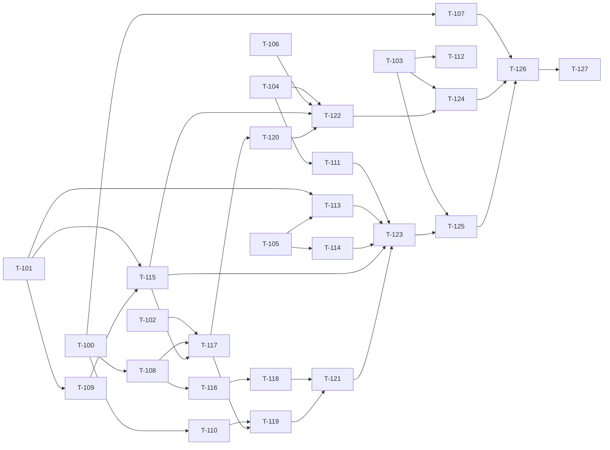

# Build Site: LLM/Vector Clients and Prompt/Database Actions

28 tasks across 10 tiers from 2 kits (cavekit-llm-vector-clients.md, cavekit-prompt-database-actions.md). Companion to build-site.md (T-001..T-096, already built); task ids start at T-100.

Previously built work is referenced as `existing: <thing>` (not as T-ids): action registry / ActionFactory, ActionSupport.save / logRecord, HttpCaller exchange / executeStrict (503/408/500 status mapping), composeLogged / fillSlotsLogged, PyRepr, Tokens (Fernet), FailureMail, ActionSettings / application.yml / CONFIG.md, StubServer, ParityKit.

Paths are relative to `action-server/src/main/java/com/kairon/action/` (main) and `action-server/src/test/java/com/kairon/action/` (test) unless stated. TDD rule for every task: write the failing test first against `StubServer` (test/support/StubServer.java) stubs for the LLM server (`/{bot}/aembedding/{llm_type}`, `/{bot}/completion/{llm_type}`) and Qdrant (`/collections/{name}/points/search`, `/collections/{name}/points/query`), assert the recorded request(s) and the result, then implement.

---

## Tier 0 — No Dependencies (Start Here)

| Task | Title | Cavekit | Requirement | blockedBy | Effort |
|------|-------|---------|-------------|-----------|--------|
| T-100 | LLM and vector config keys | cavekit-prompt-database-actions.md | R7 (+ config-and-deploy R1) | existing: ActionSettings, application.yml | S |
| T-101 | Catalog lookups: LLM secret, model, cognition schema, cognition data | cavekit-llm-vector-clients.md | R6, R7 (+ prompt-db R3) | existing: ActionCatalog, MongoActionCatalog, MemoryActionCatalog | M |
| T-102 | cl100k_base token truncation | cavekit-llm-vector-clients.md | R1 | none | S |
| T-103 | Log record keeps dynamic nulls | cavekit-prompt-database-actions.md | R7 | existing: ActionSupport.logRecord | S |
| T-104 | FAQ gate and config load for both actions | cavekit-prompt-database-actions.md | R1 | existing: ActionSupport.require, botSettings | S |
| T-105 | Extract prompt assembly into PromptParams | cavekit-prompt-database-actions.md | R2 | existing: PromptAction.llmParams, PyRepr | M |
| T-106 | Database payload builder | cavekit-prompt-database-actions.md | R6 | existing: DatabaseAction.payload | S |

- T-100: Add to ActionSettings.java/application.yml: `llm.url` (`LLM_SERVER_URL`, default `http://localhost`), `llm.request_timeout` (`LLM_REQUEST_TIMEOUT`, default 30), `vector.db` (`VECTOR_DB`, default `http://localhost:6333`), `vector.key` (`VECTOR_DB_KEY`, no default, null when unset); expose `action.request_timeout` (existing `ACTION_SERVER_REQUEST_TIMEOUT`, 60) for the vector point query. Replace the empty-default `llmUrl`/`vectorUrl` adapter semantics (keep getters until T-126). Test: config/ConfigMappingTest — defaults without env, env overrides, `vector.key` unset is null. Covers prompt-db R7 c8.
- T-101: New catalog methods (interface + Mongo + Memory): `findLlmSecret(bot, llmType)` (bot match, then global doc with no bot), `findLlmModel(bot, llmType, model)` (`models` contains model, bot then global), `findCognitionSchema(bot, collectionName)` (verbatim name), `findCognitionData(bot, collectionLower, List<{key,value}> filters, limit)` (one `$elemMatch` on `filterable_attrs` per pair, ANDed, `limit`). Test: Memory + Mongo-backed catalog tests with seeded docs (bot hit, global fallback, miss, verbatim collection name, filter AND + limit). Covers llm R6 c1, c4 (lookup half); llm R7 c1; prompt-db R3 c6 (query half).
- T-102: Add `com.knuddels:jtokkit` (check CVE audit per config-and-deploy R5); new support/TokenTruncator.java `truncate(text, 8191)` on `cl100k_base`. Test: 9000-token input decodes to exactly 8191 tokens; short input unchanged. Covers llm R1 c5 (truncation half).
- T-103: Change ActionSupport.logRecord to omit null declared fields but keep dynamic fields with null values (mongoengine DynamicDocument). Rewrite support/LogRecordTest#declaredFieldsFirstInDeclarationOrderThenDynamicNullsOmitted to assert declared nulls omitted and dynamic nulls kept (rename to ...ThenDynamicNullsKept). Run full suite; record any other action whose fixtures/tests now differ (triggers T-112). Covers prompt-db R7 c4 (null retention), R5 c11 (`recommendations` null present).
- T-104: Tests in ActionGapParityTest (or new actions/PromptDatabaseGateTest) for both actions: `enable_faq` false fails with `Faq feature is disabled for the bot! Please contact support.` and no config read (catalog spy); no `bot_settings` doc behaves as Python defaults (FAQ disabled); config read by `bot, name, status: true`; missing configs give `No action found for given bot and name` / `No Vector action found for given action and bot`. Fix PromptAction/DatabaseAction.faqDisabled so missing `llm_settings`/`enable_faq` use Python defaults instead of throwing. Covers prompt-db R1 c1-c5.
- T-105: Move PromptAction.llmParams/prepareBotResponses/question into new actions/prompt/PromptParams.java returning a typed `LlmParams` (system prompt, context, query prompt + enabled flag, history messages, similarity sources, hyperparameters, instructions, should_process_media). Fix `num_bot_responses` default to 5 (currently 0); `/`-prefixed text replaced by `kairon_user_msg` entity. Source dispatch must leave hooks for `crud` (T-113) and `action` (T-114). Test: actions/prompt/PromptParamsTest table cases per criterion. Covers prompt-db R2 c1-c11.
- T-106: Extract/verify DatabaseAction.payload into actions/database/DbPayload.java: `from_slot`, `from_user_message` (with `/` -> `kairon_user_msg` entity), `value`; `payload_search` string JSON parse with `Error converting payload to JSON: {value}`; other query types joined by single space under `embedding_search`. Test: DbPayloadTest. Covers prompt-db R6 c3-c5.

## Tier 1 — Depends on Tier 0

| Task | Title | Cavekit | Requirement | blockedBy | Effort |
|------|-------|---------|-------------|-----------|--------|
| T-107 | CONFIG.md LLM/vector rows, drop "deferred" | cavekit-prompt-database-actions.md | R7 | T-100, existing: CONFIG.md | S |
| T-108 | LLM transport (headers, timeout, no retry, errors) | cavekit-llm-vector-clients.md | R3 | T-100, existing: HttpCaller exchange | M |
| T-109 | LLM secrets and model check | cavekit-llm-vector-clients.md | R6 | T-101, existing: Tokens (Fernet) | M |
| T-110 | Qdrant similarity search request | cavekit-llm-vector-clients.md | R4 | T-100, existing: HttpCaller exchange | M |
| T-111 | Remove prompt recommendation buttons | cavekit-prompt-database-actions.md | R5 | T-104 | S |
| T-112 | [CONDITIONAL] Align other action extras with dynamic-null rule | cavekit-prompt-database-actions.md | R7 | T-103 | S |
| T-113 | crud prompt source | cavekit-prompt-database-actions.md | R3 | T-101, T-105 | M |
| T-114 | Nested action prompt source | cavekit-prompt-database-actions.md | R4 | T-105, existing: ActionFactory, action registry | M |

- T-107: CONFIG.md: rows for `llm.url`, `llm.request_timeout`, `vector.db`, `vector.key` with Python names/defaults; note `action.request_timeout` bounds the database_action point query; remove "deferred"/"keeps them off" wording for prompt_action/database_action. Test: doc review checklist; ConfigMappingTest names match table. Covers prompt-db R7 c7, c8.
- T-108: New support/LlmHttp.java `post(url, body)`: JSON POST with `X-Kairon-Request-ID` (when RequestIds has one) and the request-timestamp header, no `Authorization`; timeout `llm.request_timeout` (30 default); exactly one attempt; non-2xx -> failure with HTTP reason phrase (500 `Internal Server Error`, 404 `Not Found`); connect failure `Service Unavailable`, timeout `Request Timeout`, other `Internal Server Error`; 2xx non-JSON -> raw text. Add a per-call timeout overload to HttpCaller.exchange if missing. Test: support/LlmHttpTest with StubServer (headers recorded, 500 hit count 1, slow stub, closed port, text body). Covers llm R3 c1-c6.
- T-109: New support/llm/LlmSecrets.java: secret by `{bot, llm_type}` else global; exposes decrypted `api_key`, plus `api_version`/`api_base_url` only when non-empty; none -> `LLM secret for '{llm_type}' is not configured!`; model check -> `The model '{model}' is not available for '{llm_type}'.`; embedding secret = `openai` secret unless `llm_type` is `openai` or in excluded set `{openrouter}`. Test: LlmSecretsTest with MemoryActionCatalog + Fernet-encrypted seeds. Covers llm R6 c1-c6.
- T-110: New support/llm/QdrantClient.search(bot, source, vector): POST `{vector.db}/collections/{name}/points/search`, body `{vector, limit, with_payload: true, score_threshold}` (defaults 10 / 0.70); name `{bot}_faq_embd` for `default` else `{bot}_{collection}_faq_embd`; `api-key` = `vector.key` only when set; 5 s timeout, one request; response without `result` throws. Test: QdrantClientSearchTest (with/without key, default collection, missing result). Covers llm R4 c1-c5, c9.
- T-111: In PromptAction dispatch, always `dispatcher.text(bot_response)` (no buttons). Update ActionGapParityTest#promptActionDispatchesResponse line ~120 to assert `buttons` is `[]` even when the stub returns recommendations. Covers prompt-db R5 c10 (no-buttons half).
- T-112: [CONDITIONAL] Condition: T-103 changes the stored log of any non-prompt/database action (failing test or fixture). For each, remove null extras that Python never passes, or confirm Python stores the null and update the test/fixture. Covers prompt-db R7 c4 (regression guard).
- T-113: actions/prompt/CrudSource.java: `crud_config` `collections`, `query_source` (`slot`/`value`, default `value`), `result_limit` (10); slot mode dict as-is, string JSON-parsed, falsy = no filter, bad JSON -> `Invalid JSON format in slot value: {value}`; value mode string JSON-parsed with the raw parse error propagated (no wrapping); key/value length mismatch -> `Keys and values lists must be of the same length.`; records via T-101 by lowercased name, truthy pairs only; `data` only, decrypted when `is_secure`; per collection `Collection data for {name}:\n{PyRepr list}\n`; instructions block once after all collections. Test: CrudSourceTest. Covers prompt-db R3 c1-c10.
- T-114: actions/prompt/NestedActionSource.java: resolve by name through existing ActionFactory (inject `Provider<ActionFactory>` to break the DI cycle), run with same tracker, dispatcher, domain and request context; on success append `{name}:\n{response}\n` + instructions block; failed nested action appends nothing but its utterances and log remain; nested database_action appends nothing even on success. Test: NestedActionSourceTest with ProbeAction and a stubbed database_action. Covers prompt-db R4 c1-c4.

## Tier 2 — Depends on Tier 1

| Task | Title | Cavekit | Requirement | blockedBy | Effort |
|------|-------|---------|-------------|-----------|--------|
| T-115 | Cognition schema handling and openrouter swap | cavekit-llm-vector-clients.md | R7 | T-101, T-109 | S |
| T-116 | Completion client request/response | cavekit-llm-vector-clients.md | R2 | T-108 | M |

- T-115: support/llm/CognitionSchemas.java: lookup by `{bot, collection_name}` verbatim; empty metadata -> `training_needed` true, size 3072, `model_id` `text-embedding-3-large`; `forEmbedding()` treats missing as `training_needed` true; `forAction()` throws on missing; `resolveProvider(collection, schema, llmType)` swaps to `openrouter` and both secrets to the openrouter secret when collection != `default` and `training_needed` false. Test: CognitionSchemasTest. Covers llm R7 c1, c2, c3 (helper), c5.
- T-116: support/llm/LlmClient.complete(...): POST `{llm.url}/{url-quoted bot}/completion/{llm_type}` with body keys `messages, hyperparameters, user, invocation, media_ids` (`[]` when none), `should_process_media`; object response -> content `formatted_response`, raw `response`; non-object -> both body; call id `litellm_call_id` else `openrouter_call_id` when raw is an object, else null; non-2xx via T-108. Test: LlmClientCompletionTest. Covers llm R2 c1-c4, c9.

## Tier 3 — Depends on Tier 2

| Task | Title | Cavekit | Requirement | blockedBy | Effort |
|------|-------|---------|-------------|-----------|--------|
| T-117 | Embedding client | cavekit-llm-vector-clients.md | R1 | T-102, T-108, T-115 | M |
| T-118 | Message building, rephrase and perplexity | cavekit-llm-vector-clients.md | R2 | T-116 | M |

- T-117: LlmClient.embed(bot, llmType, texts|text, sender, invocation, collection, secret): POST `{llm.url}/{url-quoted bot}/aembedding/{llm_type}`, body `{text: [...], user, kwargs}`; `kwargs.invocation` (`prompt_action` / `db_action_qdrant`), `collection` + `model` only when schema `training_needed` false (missing schema = true via T-115), `truncated_texts` via T-102, `api_key` from embedding secret (T-109); single input + list response -> first element; list input -> full response; non-2xx via T-108. Test: LlmClientEmbeddingTest. Covers llm R1 c1-c8, R7 c3.
- T-118: LlmClient.answer(params): rephrase first when query prompt enabled and non-empty (`{invocation}_rephrase`, `[system, user "{query_prompt}\n\n Q: {query}\n A:"]`, `media_ids` `[]`, `should_process_media` false; content replaces query); main messages `[system, history..., user]` (history omitted when empty); user content with/without instructions (joined `\n`); perplexity `search_domain_filter` suffix ` inurl:d1|d2`. Test: LlmClientMessagesTest asserting recorded request bodies in order. Covers llm R2 c5-c8.

## Tier 4 — Depends on Tier 3

| Task | Title | Cavekit | Requirement | blockedBy | Effort |
|------|-------|---------|-------------|-----------|--------|
| T-119 | Similarity context rendering and concurrency | cavekit-llm-vector-clients.md | R4 | T-110, T-117 | M |
| T-120 | Vector point query (database action) | cavekit-llm-vector-clients.md | R5 | T-117 | M |

- T-119: support/llm/SimilarityContext.java: one embedding, then all enabled sources searched concurrently (CompletableFuture on blocking executor), blocks appended in config order; hit value = `payload.content` else payload minus `collection_name`; non-empty -> `"Instructions on how to use {name}:\n{PyRepr list}\n{instructions}\n"`; empty adds nothing. Test: SimilarityContextTest with a latch-gated stub proving both searches in flight, plus ordering and rendering. Covers llm R4 c6-c8.
- T-120: QdrantClient.query(bot, collection, payload, schema, secret): POST `{vector.db}/collections/{bot}_{collection}_faq_embd/points/query`; `query` = embedding of non-empty `embedding_search` (`db_action_qdrant`); `payload_search` merged top-level; `with_payload: true` + `limit` (10) when body non-empty; empty -> `No Operation to perform`; no `api-key` even when `vector.key` set; timeout `action.request_timeout` (60); status not in 200/201/202/204 -> `Got non-200 status code: {code} {body}`; other errors -> `Failed to execute the url: ...`; success returns JSON (or text) unmodified. Test: QdrantClientQueryTest. Covers llm R5 c1-c10.

## Tier 5 — Depends on Tier 4

| Task | Title | Cavekit | Requirement | blockedBy | Effort |
|------|-------|---------|-------------|-----------|--------|
| T-121 | Prediction orchestration and LLM log capture | cavekit-llm-vector-clients.md | R8 | T-118, T-119 | M |
| T-122 | Database execute against Qdrant | cavekit-prompt-database-actions.md | R6 | T-104, T-106, T-115, T-120 | M |

- T-121: support/llm/LlmProcessor.predict(...): embedding -> similarity -> completion; each completion appends `{messages, raw_completion_response, type, hyperparameters}` (`rephrase_query` / `answer_query`) in call order; failure before embedding returns -> `{"error": "Creating a new embedding for the provided query. <exc>"}`, after -> `{"error": "Retrieving chat completion for the provided query. <exc>"}`; failure result `{is_failure: true, exception, content: null}`; success `{content, similarity_context, litellm_call_id}`; elapsed = wall-clock seconds of the whole prediction. Test: LlmProcessorTest (success, embed 500, completion 500, rephrase + answer log order). Covers llm R8 c1-c6.
- T-122: Rewrite DatabaseAction.execute: keep db_type check before payload and missing-schema-before-payload order; `forAction()` schema (T-115), openrouter provider/secret when `training_needed` false; payload via T-106; query via T-120; compose result with existing composeLogged and fill slots with existing fillSlotsLogged using context `{data, context}`; returned slots = filled + `kairon_action_response`. Test: update ActionGapParityTest#databaseActionDispatchesResponse to Qdrant + LLM stubs (asserts embedding request, query body, no api-key); keep databaseActionRejectsUnknownDbTypeBeforeBuildingPayload and databaseActionMissingSchemaFailsBeforePayloadIsLogged green. Covers prompt-db R6 c1, c2, c6, c7, c8, c11; llm R5 c11, R7 c4, c5.

## Tier 6 — Depends on Tier 5

| Task | Title | Cavekit | Requirement | blockedBy | Effort |
|------|-------|---------|-------------|-----------|--------|
| T-123 | Prompt execute against LLM server and Qdrant | cavekit-prompt-database-actions.md | R5 | T-111, T-113, T-114, T-115, T-121 | M |
| T-124 | Database error, dispatch and log parity | cavekit-prompt-database-actions.md | R6, R7 | T-103, T-122 | M |

- T-123: Rewrite PromptAction.execute on PromptParams (T-105 with crud T-113 and nested T-114 wired in): cognition handling for a non-default first similarity collection (missing schema fails), then model check on `hyperparameters.model`, both before any LLM call (assert zero stub hits on failure); predict with invocation `prompt_action`, tracker `media_ids`, first similarity collection; `is_failure` -> status `Failed`, exception from result; slots filled from `{data: content, context}`; returned slots `kairon_action_response`, `llm_call_id`. Test: ActionGapParityTest prompt cases with LLM + Qdrant stubs (success, missing schema, unknown model, is_failure). Covers prompt-db R2 c10 (end-to-end), R4 c1 (integration), R5 c1-c3, c6, c7; llm R7 c4.
- T-124: DatabaseAction error/log: `bot_response` = `failure_response` (default `I have failed to process your request.` when config not loaded); failure mail on every error incl. FAQ-disabled; dispatch text when `response.dispatch` true on success and failure; log `response`/`bot_response` as PyRepr when truthy, else `response` null (kept, dynamic) and `bot_response` omitted (declared); field order declared non-null `type, intent, action, sender, headers, bot_response, exception, messages, bot, timestamp, status, trigger_info, request_id` then `config, payload, response, user_msg`; declared nulls (e.g. `exception`) omitted. Test: ActionGapParityTest database log key-order and null assertions; RecordingFailureMail for FAQ-disabled. Covers prompt-db R6 c9, c10; R7 c1 (kept), c2-c4.

## Tier 7 — Depends on Tier 6

| Task | Title | Cavekit | Requirement | blockedBy | Effort |
|------|-------|---------|-------------|-----------|--------|
| T-125 | Prompt error, output and log parity | cavekit-prompt-database-actions.md | R5, R7 | T-103, T-123 | M |

- T-125: PromptAction output/log: events `[llm_response{response, llm_response_log, time_elapsed}, slots_to_fill{data, slot_eval_log, time_elapsed}]`; on error `bot_response` = FAQ-disabled text / `failure_message` / default NLU fallback; failure mail except FAQ-disabled; dispatch one text message when `dispatch_response` true (default); log dynamic order `events, recommendations (null), llm_response, kairon_faq_action_config (no _id), llm_logs, user_msg, media_ids, time_elapsed, llm_call_id` (current code puts `llm_call_id` before `user_msg`: fix); `time_elapsed` = prediction + slot-fill seconds. Include crud value-mode bad JSON case: status `Failed`, `exception` = parse error text, generic failure response + mail. Test: ActionGapParityTest + ActionLogEventsTest key-order assertions. Covers prompt-db R1 c6 (kept), R3 c5 (failure path), R5 c4, c5, c8-c11; R7 c5.

## Tier 8 — Depends on Tier 7

| Task | Title | Cavekit | Requirement | blockedBy | Effort |
|------|-------|---------|-------------|-----------|--------|
| T-126 | Remove remote-adapter code | cavekit-prompt-database-actions.md | R7 | T-107, T-124, T-125 | S |

- T-126: Delete adapter leftovers: `llm url is not configured` / `vector url is not configured` checks, adapter javadocs in PromptAction/DatabaseAction, `vectorUrl`/`llmUrl` adapter fields and `kairon.action.vector-url`/`llm-url` keys (superseded by T-100 names), ParityKit `/llm` and `/vector` adapter stubs (ParityKit.java ~147-148, ~431-435) replaced by LLM-server and Qdrant path stubs; grep confirms no "deferred" text for these actions in CONFIG.md/javadocs. Test: full `./gradlew test`. Covers prompt-db R7 c7 (code/doc half).

## Tier 9 — Depends on Tier 8

| Task | Title | Cavekit | Requirement | blockedBy | Effort |
|------|-------|---------|-------------|-----------|--------|
| T-127 | End-to-end webhook scenarios with LLM and Qdrant stubs | cavekit-prompt-database-actions.md | R2-R6 (+ llm R1-R8) | T-126 | M |

- T-127: WebhookTest-level scenarios through POST /webhook: prompt with system + history + two bot_content sources + slot + crud + nested http action + query prompt (asserts rephrase, embedding, two concurrent searches, completion bodies, response envelope, log); database_action with embedding_search + payload_search. Optional: add synthetic parity fixtures under src/test/resources/parity/fixtures. Covers regression of prompt-db R2-R6 and llm R1, R2, R4, R5, R8 as an integrated path.

---

## Summary

| Tier | Tasks | Effort |
|------|-------|--------|
| 0 | 7 | 5S 2M |
| 1 | 8 | 3S 5M |
| 2 | 2 | 1S 1M |
| 3 | 2 | 2M |
| 4 | 2 | 2M |
| 5 | 2 | 2M |
| 6 | 2 | 2M |
| 7 | 1 | 1M |
| 8 | 1 | 1S |
| 9 | 1 | 1M |

**Total: 28 tasks, 10 tiers** (effort 10S 18M)

## Notes and Risks

- P1: Python `json.loads` error text (e.g. `Expecting value: line 1 column 1 (char 0)`) differs from Jackson's; prompt-db R3 c5 logs it as `exception`. T-113 should map common Jackson failures to Python `JSONDecodeError` text or flag the residual difference in the fixture matcher.
- P1: T-103 changes logRecord for every action type; T-112 is the guard.
- P2: PromptAction -> ActionFactory -> List<KaironAction> DI cycle for nested actions (T-114 uses `Provider<ActionFactory>`).
- P2: jtokkit is a new dependency (T-102); include it in the CVE audit.
- P3: HTTP reason phrases (T-108) must use the Python `http.HTTPStatus` phrase table, not the JDK's.

## Dependency Graph

## Coverage Matrix

121 criteria (llm-vector-clients 60, prompt-database-actions 61); 121 covered, 0 gaps (100%).

| Cavekit | Req | Criterion | Task(s) | Status |
|---------|-----|-----------|---------|--------|
| cavekit-llm-vector-clients.md | R1 | POST to `{llm.url}/{bot}/aembedding/{llm_type}` | T-117 | COVERED |
| cavekit-llm-vector-clients.md | R1 | Body `{text: [...], user, kwargs}`; single string as one-element list | T-117 | COVERED |
| cavekit-llm-vector-clients.md | R1 | `kwargs.invocation` prompt_action / db_action_qdrant | T-117, T-120 | COVERED |
| cavekit-llm-vector-clients.md | R1 | `collection` + `model` only when `training_needed` false | T-115, T-117 | COVERED |
| cavekit-llm-vector-clients.md | R1 | `truncated_texts` cut to 8191 cl100k_base tokens | T-102, T-117 | COVERED |
| cavekit-llm-vector-clients.md | R1 | `kwargs.api_key` is embedding secret's api_key | T-109, T-117 | COVERED |
| cavekit-llm-vector-clients.md | R1 | Single input + list response -> first element; list input -> full | T-117 | COVERED |
| cavekit-llm-vector-clients.md | R1 | Status outside 200-204 fails per R3 | T-108, T-117 | COVERED |
| cavekit-llm-vector-clients.md | R2 | POST to `{llm.url}/{bot}/completion/{llm_type}` | T-116 | COVERED |
| cavekit-llm-vector-clients.md | R2 | Body keys messages, hyperparameters, user, invocation, media_ids, should_process_media | T-116 | COVERED |
| cavekit-llm-vector-clients.md | R2 | Object response -> formatted_response / response; else body | T-116 | COVERED |
| cavekit-llm-vector-clients.md | R2 | Call id litellm_call_id else openrouter_call_id, else null | T-116 | COVERED |
| cavekit-llm-vector-clients.md | R2 | Rephrase completion first when query prompt enabled | T-118 | COVERED |
| cavekit-llm-vector-clients.md | R2 | Main messages [system, history..., user], history omitted when empty | T-118 | COVERED |
| cavekit-llm-vector-clients.md | R2 | User content format with/without instructions | T-118 | COVERED |
| cavekit-llm-vector-clients.md | R2 | Perplexity search_domain_filter ` inurl:d1|d2` suffix | T-118 | COVERED |
| cavekit-llm-vector-clients.md | R2 | Status outside 200-204 fails per R3 | T-108, T-116 | COVERED |
| cavekit-llm-vector-clients.md | R3 | X-Kairon-Request-ID + timestamp header, no Authorization | T-108 | COVERED |
| cavekit-llm-vector-clients.md | R3 | Timeout `llm.request_timeout`, default 30 | T-100, T-108 | COVERED |
| cavekit-llm-vector-clients.md | R3 | Exactly one request incl. 5xx | T-108 | COVERED |
| cavekit-llm-vector-clients.md | R3 | Non-2xx fails with HTTP status phrase | T-108 | COVERED |
| cavekit-llm-vector-clients.md | R3 | Connection -> Service Unavailable, timeout -> Request Timeout, other -> Internal Server Error | T-108 | COVERED |
| cavekit-llm-vector-clients.md | R3 | 2xx non-JSON kept as raw text | T-108 | COVERED |
| cavekit-llm-vector-clients.md | R4 | POST `/collections/{name}/points/search` with body vector/limit/with_payload/score_threshold | T-110 | COVERED |
| cavekit-llm-vector-clients.md | R4 | limit = top_results (10), score_threshold = similarity_threshold (0.70) | T-105, T-110 | COVERED |
| cavekit-llm-vector-clients.md | R4 | Collection `{bot}_faq_embd` for default else `{bot}_{collection}_faq_embd` | T-110 | COVERED |
| cavekit-llm-vector-clients.md | R4 | `api-key` = vector.key when set, else omitted | T-100, T-110 | COVERED |
| cavekit-llm-vector-clients.md | R4 | Timeout 5 s, one request per search | T-110 | COVERED |
| cavekit-llm-vector-clients.md | R4 | Two sources searched concurrently, blocks in config order | T-119 | COVERED |
| cavekit-llm-vector-clients.md | R4 | Hit contributes payload.content else payload minus collection_name | T-119 | COVERED |
| cavekit-llm-vector-clients.md | R4 | Context block format with hits; nothing without | T-119 | COVERED |
| cavekit-llm-vector-clients.md | R4 | Response without `result` fails the prediction | T-110, T-121 | COVERED |
| cavekit-llm-vector-clients.md | R5 | POST `/collections/{bot}_{collection}_faq_embd/points/query` | T-120 | COVERED |
| cavekit-llm-vector-clients.md | R5 | `query` = embedding of non-empty embedding_search | T-120 | COVERED |
| cavekit-llm-vector-clients.md | R5 | payload_search merged top-level | T-120 | COVERED |
| cavekit-llm-vector-clients.md | R5 | with_payload true + limit (10) when body has content | T-120 | COVERED |
| cavekit-llm-vector-clients.md | R5 | No query and no payload_search -> `No Operation to perform` | T-120 | COVERED |
| cavekit-llm-vector-clients.md | R5 | No api-key header even when vector.key set | T-120 | COVERED |
| cavekit-llm-vector-clients.md | R5 | Timeout action.request_timeout (60) | T-100, T-120 | COVERED |
| cavekit-llm-vector-clients.md | R5 | Non-200 -> `Got non-200 status code: {code} {body}` | T-120 | COVERED |
| cavekit-llm-vector-clients.md | R5 | Other error -> `Failed to execute the url:` prefix | T-120 | COVERED |
| cavekit-llm-vector-clients.md | R5 | Success returns Qdrant JSON/text unmodified | T-120 | COVERED |
| cavekit-llm-vector-clients.md | R5 | db_type other than qdrant -> `Database not yet implemented!` | T-122 (regression) | COVERED-existing (ActionGapParityTest#databaseActionRejectsUnknownDbTypeBeforeBuildingPayload) |
| cavekit-llm-vector-clients.md | R6 | Secret by {bot, llm_type} then global | T-101, T-109 | COVERED |
| cavekit-llm-vector-clients.md | R6 | Exposes decrypted api_key; api_version/api_base_url only when non-empty | T-109 | COVERED |
| cavekit-llm-vector-clients.md | R6 | No secret -> `LLM secret for '{llm_type}' is not configured!` | T-109 | COVERED |
| cavekit-llm-vector-clients.md | R6 | Model check bot then global; miss message | T-101, T-109, T-123 | COVERED |
| cavekit-llm-vector-clients.md | R6 | Embedding secret = openai unless openai/excluded | T-109 | COVERED |
| cavekit-llm-vector-clients.md | R6 | Excluded types exactly `openrouter` | T-109 | COVERED |
| cavekit-llm-vector-clients.md | R7 | Schema by {bot, collection_name} verbatim | T-101, T-115 | COVERED |
| cavekit-llm-vector-clients.md | R7 | Empty metadata -> training_needed true, 3072, text-embedding-3-large | T-115 | COVERED |
| cavekit-llm-vector-clients.md | R7 | Embedding client treats missing schema as training_needed true | T-115, T-117 | COVERED |
| cavekit-llm-vector-clients.md | R7 | Prompt/database actions fail on missing schema | T-122, T-123 | COVERED (database half also existing: ActionGapParityTest#databaseActionMissingSchemaFailsBeforePayloadIsLogged) |
| cavekit-llm-vector-clients.md | R7 | Non-default + training_needed false -> openrouter type and secrets | T-115, T-122, T-123 | COVERED |
| cavekit-llm-vector-clients.md | R8 | Each completion appends {messages, raw_completion_response, type, hyperparameters} in order | T-121 | COVERED |
| cavekit-llm-vector-clients.md | R8 | Pre-embedding failure log entry text | T-121 | COVERED |
| cavekit-llm-vector-clients.md | R8 | Post-embedding failure log entry text | T-121 | COVERED |
| cavekit-llm-vector-clients.md | R8 | Failure result {is_failure, exception, content: null} | T-121 | COVERED |
| cavekit-llm-vector-clients.md | R8 | Success result {content, similarity_context, litellm_call_id} | T-121 | COVERED |
| cavekit-llm-vector-clients.md | R8 | Elapsed = wall-clock seconds of whole prediction | T-121 | COVERED |
| cavekit-prompt-database-actions.md | R1 | FAQ check before config lookup; disabled message, no config read | T-104 | COVERED |
| cavekit-prompt-database-actions.md | R1 | No bot_settings -> Python defaults (FAQ disabled) | T-104 | COVERED |
| cavekit-prompt-database-actions.md | R1 | Config read by bot, name, status true | T-104 | COVERED |
| cavekit-prompt-database-actions.md | R1 | Missing prompt config message | T-104 | COVERED |
| cavekit-prompt-database-actions.md | R1 | Missing database config message | T-104 | COVERED |
| cavekit-prompt-database-actions.md | R1 | `_id` absent from logged config | T-125 (regression) | COVERED-existing (ActionGapParityTest#promptActionDispatchesResponse) |
| cavekit-prompt-database-actions.md | R2 | Disabled skipped; enabled in config order | T-105 | COVERED |
| cavekit-prompt-database-actions.md | R2 | System prompt `{data}\n`, last wins | T-105 | COVERED |
| cavekit-prompt-database-actions.md | R2 | Query prompts accumulate and enable | T-105 | COVERED |
| cavekit-prompt-database-actions.md | R2 | History last num_bot_responses (5), stop at session start | T-105 | COVERED |
| cavekit-prompt-database-actions.md | R2 | History roles user/assistant, oldest first | T-105 | COVERED |
| cavekit-prompt-database-actions.md | R2 | bot_content adds similarity source with defaults | T-105 | COVERED |
| cavekit-prompt-database-actions.md | R2 | slot source `{name}:\n{value}\n`, null -> None | T-105 | COVERED |
| cavekit-prompt-database-actions.md | R2 | Other source `{name}:\n{data}\n` | T-105 | COVERED |
| cavekit-prompt-database-actions.md | R2 | Instructions block for context sources | T-105 | COVERED |
| cavekit-prompt-database-actions.md | R2 | hyperparameters, instructions, should_process_media reach completion | T-105, T-118, T-123 | COVERED |
| cavekit-prompt-database-actions.md | R2 | user_question from_slot else latest text with `/` -> kairon_user_msg | T-105 | COVERED |
| cavekit-prompt-database-actions.md | R3 | crud_config collections, query_source (value), result_limit (10) | T-113 | COVERED |
| cavekit-prompt-database-actions.md | R3 | Slot mode dict / JSON string / falsy | T-113 | COVERED |
| cavekit-prompt-database-actions.md | R3 | Unparseable slot -> `Invalid JSON format in slot value: {value}` | T-113 | COVERED |
| cavekit-prompt-database-actions.md | R3 | Value mode string parsed as JSON | T-113 | COVERED |
| cavekit-prompt-database-actions.md | R3 | Unparseable value-mode -> parse error as exception, generic failure path | T-113, T-125 | COVERED |
| cavekit-prompt-database-actions.md | R3 | Records by lowercased name + bot, ANDed elemMatch, limit | T-101, T-113 | COVERED |
| cavekit-prompt-database-actions.md | R3 | Only `data`, decrypted when is_secure | T-113 | COVERED |
| cavekit-prompt-database-actions.md | R3 | Key/value length mismatch message | T-113 | COVERED |
| cavekit-prompt-database-actions.md | R3 | `Collection data for {name}:\n{repr}\n` per collection | T-113 | COVERED |
| cavekit-prompt-database-actions.md | R3 | Collection instructions block once | T-113 | COVERED |
| cavekit-prompt-database-actions.md | R4 | Nested resolved by type resolution, same tracker/dispatcher/domain/request | T-114, T-123 | COVERED |
| cavekit-prompt-database-actions.md | R4 | Success appends `{name}:\n{response}\n` + instructions | T-114 | COVERED |
| cavekit-prompt-database-actions.md | R4 | Failed nested appends nothing; its utterances and log remain | T-114 | COVERED |
| cavekit-prompt-database-actions.md | R4 | Nested database_action appends nothing | T-114 | COVERED |
| cavekit-prompt-database-actions.md | R5 | Cognition then model check before any LLM call | T-123 | COVERED |
| cavekit-prompt-database-actions.md | R5 | Invocation prompt_action, media_ids slot, first similarity collection | T-123 | COVERED |
| cavekit-prompt-database-actions.md | R5 | is_failure -> Failed + exception | T-123 | COVERED |
| cavekit-prompt-database-actions.md | R5 | Log events [llm_response, slots_to_fill] | T-125 (regression) | COVERED-existing (ActionGapParityTest#promptActionDispatchesResponse) |
| cavekit-prompt-database-actions.md | R5 | llm_response / slots_to_fill event fields | T-125 | COVERED |
| cavekit-prompt-database-actions.md | R5 | Slots filled from {data: content, context} | T-123 | COVERED |
| cavekit-prompt-database-actions.md | R5 | Returned slots kairon_action_response + llm_call_id | T-123 | COVERED |
| cavekit-prompt-database-actions.md | R5 | Error bot_response FAQ text / failure_message / default fallback | T-125 | COVERED |
| cavekit-prompt-database-actions.md | R5 | Failure mail except FAQ-disabled | T-125 | COVERED |
| cavekit-prompt-database-actions.md | R5 | dispatch_response true -> one text message, no buttons | T-111, T-125 | COVERED |
| cavekit-prompt-database-actions.md | R5 | Log field list incl. recommendations null; time_elapsed = prediction + slot fill | T-103, T-125 | COVERED |
| cavekit-prompt-database-actions.md | R6 | Unsupported db_type fails before payload, messages empty | T-122 (regression) | COVERED-existing (ActionGapParityTest#databaseActionRejectsUnknownDbTypeBeforeBuildingPayload) |
| cavekit-prompt-database-actions.md | R6 | Missing schema fails before payload logged | T-122 (regression) | COVERED-existing (ActionGapParityTest#databaseActionMissingSchemaFailsBeforePayloadIsLogged) |
| cavekit-prompt-database-actions.md | R6 | Payload item from_slot / from_user_message / value | T-106 | COVERED |
| cavekit-prompt-database-actions.md | R6 | payload_search JSON parse, error message | T-106 | COVERED |
| cavekit-prompt-database-actions.md | R6 | Other query types joined by space under embedding_search | T-106 | COVERED |
| cavekit-prompt-database-actions.md | R6 | training_needed false -> openrouter provider and secret | T-115, T-122 | COVERED |
| cavekit-prompt-database-actions.md | R6 | Vector query per llm R5, composed with {data, context} | T-120, T-122 | COVERED |
| cavekit-prompt-database-actions.md | R6 | messages = payload, compose log, slot-eval log | T-122 (regression) | COVERED-existing (ActionGapParityTest#databaseActionDispatchesResponse) |
| cavekit-prompt-database-actions.md | R6 | Error bot_response failure_response (default) + mail incl. FAQ-disabled | T-124 | COVERED |
| cavekit-prompt-database-actions.md | R6 | response.dispatch true -> utter on success and failure | T-124 | COVERED |
| cavekit-prompt-database-actions.md | R6 | Returned slots = filled + kairon_action_response | T-122 | COVERED |
| cavekit-prompt-database-actions.md | R7 | Database log payload is Python repr | T-124 (regression) | COVERED-existing (ActionGapParityTest#databaseActionDispatchesResponse) |
| cavekit-prompt-database-actions.md | R7 | response/bot_response repr when truthy; falsy response null, bot_response omitted | T-124 | COVERED |
| cavekit-prompt-database-actions.md | R7 | Database log field order (declared non-null, then config, payload, response, user_msg) | T-124 | COVERED |
| cavekit-prompt-database-actions.md | R7 | Dynamic payload/response kept as null; declared nulls omitted | T-103, T-112, T-124 | COVERED |
| cavekit-prompt-database-actions.md | R7 | Prompt log field order (declared, then events ... llm_call_id) | T-103, T-125 | COVERED |
| cavekit-prompt-database-actions.md | R7 | prompt_action / database_action resolve through type resolution | T-122, T-123 (regression) | COVERED-existing (ActionGapParityTest#promptActionDispatchesResponse, ActionGapParityTest#databaseActionDispatchesResponse) |
| cavekit-prompt-database-actions.md | R7 | Config docs no longer describe the actions as deferred | T-107, T-126 | COVERED |
| cavekit-prompt-database-actions.md | R7 | LLM/vector config keys per config-and-deploy R1 | T-100, T-107 | COVERED |
