# Build Site

96 tasks across 5 tiers from 10 kits.

---

## Tier 0 — No Dependencies (Start Here)

| Task | Title | Cavekit | Requirement | Effort |
|------|-------|------|------------|--------|
| T-001 | Config mapping to Python env names | cavekit-config-and-deploy.md | R1 | M |
| T-002 | Micronaut bump to 4.10.24+ | cavekit-config-and-deploy.md | R5 | S |
| T-003 | UUID representation PYTHON_LEGACY | cavekit-config-and-deploy.md | R3 | S |
| T-004 | Blocking executor for webhook | cavekit-config-and-deploy.md | R6 | S |
| T-005 | Python repr and json.dumps serializer | cavekit-templating-and-secrets.md | R7 | M |
| T-006 | Fernet interop test suite | cavekit-templating-and-secrets.md | R5 | M |
| T-007 | HS256 JWT parity tests | cavekit-templating-and-secrets.md | R6 | M |
| T-008 | Sender id Fernet decryption | cavekit-templating-and-secrets.md | R8 | S |
| T-009 | latest_message parameter type | cavekit-templating-and-secrets.md | R3 | S |
| T-010 | Evaluation context bot and conditional key_vault | cavekit-templating-and-secrets.md | R4 | M |
| T-011 | Tracker defaults per rasa_sdk | cavekit-webhook-contract.md | R1 | S |
| T-012 | Python error contract in controller and processor | cavekit-webhook-contract.md | R1, R3 (+ dispatch R1, R3) | M |
| T-013 | Correct WebhookTest error-contract tests | cavekit-webhook-contract.md | R3 | S |
| T-014 | Request id generation | cavekit-webhook-contract.md | R4 | S |
| T-015 | Full Python secure-header set | cavekit-webhook-contract.md | R4 | M |
| T-016 | Request body-size ceiling | cavekit-webhook-contract.md | R6 | S |
| T-017 | Redirect policy and credential stripping | cavekit-outbound-clients.md | R3 (+ config R5) | M |
| T-018 | Form and query wire encoding | cavekit-outbound-clients.md | R4 | M |
| T-019 | Single multipart request for media_ids | cavekit-outbound-clients.md | R8 | M |
| T-020 | Raising exchange and expression evaluator tests | cavekit-outbound-clients.md | R2, R6 | S |
| T-021 | Pyscript evaluator client tests | cavekit-outbound-clients.md | R5 | S |
| T-022 | SMTP client | cavekit-outbound-clients.md | R7 | L |
| T-023 | Python chat-log HTML template | cavekit-outbound-clients.md | R7 | S |
| T-024 | Fixture schema v1 | cavekit-parity-harness.md | R2 | S |
| T-025 | Pytest fixture recorder | cavekit-parity-harness.md | R1, R2 | L |
| T-026 | Capture reference job documents | cavekit-events-schedule-api.md | R1 | S |
| T-027 | Schedule request model and validation | cavekit-events-schedule-api.md | R1, R4 | M |
| T-028 | Disable deferred types and LLM rephrase | cavekit-dispatch-and-logging.md | R1 (+ core R4) | M |
| T-029 | Two-stage text search parity | cavekit-core-actions.md | R3 | M |
| T-030 | Google search website parameter | cavekit-integration-actions.md | R3 | S |
| T-031 | Voice call provider request | cavekit-integration-actions.md | R12 | M |
| T-032 | Health endpoints verification | cavekit-webhook-contract.md | R5 | S |

- T-001: Rename env vars in application.yml/ActionSettings.java to system.yaml names and defaults (DATABASE_URL with default DB `kairon` in catalog/MongoFactory.java, ACTION_SERVER_REQUEST_TIMEOUT=60, FERNET_KEY, SECRET_KEY, PYSCRIPT_EVALUATOR_ENDPOINT, EVENT_SERVER_ENDPOINT, SECRET_UNMASKED_CHAR_COUNT, ...); add AES key/IV, support mail, CORS origins, own-webhook URL settings; write action-server/CONFIG.md Python-key to port-key table. Covers config-and-deploy R1 c1-c5.
- T-002: Raise Micronaut version in action-server/build.gradle:38 out of the GHSA-q6gh-6v2r-hjv3 range; run dependency audit. Covers config-and-deploy R5 c1.
- T-003: Set uuidRepresentation PYTHON_LEGACY on the client settings in catalog/MongoFactory.java; round-trip a subtype-3 UUID. Covers config-and-deploy R3 c1.
- T-004: Add @ExecuteOn(TaskExecutors.BLOCKING) to server/WebhookController.java (or thread-selection AUTO) so Mongo/SMTP/HTTP leave the event loop. Covers config-and-deploy R6 c1.
- T-005: New support/PyRepr.java (str(dict): quote switching, True/False/None) and Python-compatible json.dumps in support/Jsons.java (', '/': ' separators, ASCII escapes, float format 1e+16/1.0, insertion order); golden-string unit tests captured from CPython. Covers templating-and-secrets R7 c1-c7.
- T-006: Add FernetInteropTest for support/Tokens.java: public spec vectors, Python-generated tokens (checked-in vectors from a cryptography script), port tokens decrypted by Python, no-TTL and tamper/wrong-key failure. Covers templating-and-secrets R5 c1-c5.
- T-007: Tests for store-page and agent integration tokens in support/Tokens.java: HS256, header order typ/alg, payload claim sets, Fernet `sub` decrypted with Python and compared ignoring jti/iat/exp, Python server accepts port token (human review). Covers templating-and-secrets R6 c1-c5.
- T-008: Decrypt sender_id in runtime/TrackerState.java when it is a valid Fernet token under the configured key, else keep as-is. Covers templating-and-secrets R8 c1-c2.
- T-009: Add `latest_message` branch to parameter resolution in support/ActionSupport.java:127-151. Covers templating-and-secrets R3 c3.
- T-010: Add `bot` to support/ActionSupport.context(); include key_vault only when the action config requests it; update callers (HttpAction, PyscriptAction, CallbackAction, ...) to pass the config flag. Covers templating-and-secrets R4 c1-c2.
- T-011: Model paused (false), active_loop with active_form fallback then {}, latest_action_name (null), stack ([]) in runtime/TrackerState.java. Covers webhook-contract R1 c5, c7-c10.
- T-012: server/WebhookController.java + server/ActionProcessor.java: missing tracker or sender_id -> 500; empty/non-object body -> 200 {success:false,error_code:422,message:[...],data:null}; catch-all returns responses []; never 422 status; strip (not lowercase) next_action. Covers webhook-contract R1 c11; webhook-contract R3 c2-c5; dispatch-and-logging R1 c4; dispatch-and-logging R3 c1.
- T-013: Rewrite WebhookTest.java missingTrackerIs422/emptyBodyIs422 and related assertions to the Python contract (200 null, 500, 200 error envelope, 200 empty envelope, no 422 status). Covers webhook-contract R3 c1-c5.
- T-014: server/SecurityFilter.java + runtime/RequestIds.java: generate UUID4 when X-Kairon-Request-ID absent, echo it on the response and expose it to logging. Covers webhook-contract R4 c1-c2.
- T-015: Add HSTS, Permissions-Policy, Server: Secure, COEP/COOP/CORP and align CSP/Cache-Control values in server/SecurityFilter.java to values captured from kairon/actions server middleware; header-value test. Covers webhook-contract R4 c6-c7.
- T-016: Set micronaut.server.max-request-size above 20 MB in application.yml; 20 MB tracker test; document ceiling for human sign-off. Covers webhook-contract R6 c1-c2.
- T-017: Manual redirect loop in support/HttpCaller.java: max 10 hops, 301/302/303 POST->GET without body, 307/308 keep method/body, drop Authorization/Cookie/Proxy-Authorization cross-origin, TLS verification on; stub-server tests. Covers outbound-clients R3 c1-c5; config-and-deploy R5 c2.
- T-018: support/HttpCaller.java:84-147: nested dict -> its keys, list -> repeated keys, drop nulls in form, `+` for spaces incl. placeholder-substituted URLs, JSON content type without charset; record downstream sensitivity for human review. Covers outbound-clients R4 c1-c6.
- T-019: Rework support/HttpCaller.java:187-210 multipart() to send one request with one file part per media id, mirroring Python part naming. Covers outbound-clients R8 c1.
- T-020: Stub-server unit tests for the raising HttpCaller path (error text, GET query, json/form body, timestamp header) and the expression evaluator client ({script,data}, success:false error, non-2xx). Covers outbound-clients R2 c1-c4; outbound-clients R6 c1-c4.
- T-021: Stub-server unit tests for the pyscript evaluator call in support/ActionSupport.java: request body, statusCode!=200 raises, `bot` removed, output fallback, media_ids appended. Covers outbound-clients R5 c1-c5.
- T-022: New support/SmtpMailer.java (Jakarta Mail or Micronaut Email): host/port/user/password/TLS from resolved params, one message per recipient, subject `{sender_id} {subject}`, HTML body; GreenMail test. Covers outbound-clients R7 c1-c3.
- T-023: Replace the ad-hoc chat-log HTML in support/ActionSupport.java:557-569 with a port of the Python email template; custom_text path unchanged; golden-HTML test. Covers outbound-clients R7 c4.
- T-024: Write tests/parity/fixture-schema.md + JSON Schema with schema_version, every fixture field and every placeholder token. Covers parity-harness R2 c1-c2.
- T-025: tests/parity/recorder.py conftest plugin (opt-in via env/flag, no test-file edits): capture Mongo seeds, inbound webhook request, mocked upstream calls (responses/aioresponses) with canned replies, webhook response and written Mongo docs; one file per passing node id; canonical extended JSON. Covers parity-harness R1 c1-c4; parity-harness R2 c3.
- T-026: Before migration, capture one pyscript and one flow job document from today's kairon/actions/definitions/schedule.py direct write as fixtures under tests/testing_data. Covers events-schedule-api R1 c7.
- T-027: Pydantic model in kairon/events/models.py: job_id (32 lowercase hex), run_at ISO 8601, timezone, schedule_action_type in {pyscript, flow}, schedule_action, bot, user, data; missing/invalid -> 200 {success:false,error_code:422}. Covers events-schedule-api R1 c2; events-schedule-api R4 c1-c2.
- T-028: Unregister prompt_action/database_action in actions/ActionFactory.java (they fail with `<type> type action is not supported with action server`), keep PromptAction.java/DatabaseAction.java on disk but unreachable (deferred cycle will reuse them); remove the rephrase path in BotResponseAction.java/Kairon.java; log enable_rephrasing from settings, is_rephrased false, raw_gpt_response null. Covers dispatch-and-logging R1 c6; core-actions R4 c4.
- T-029: Replace in-memory substring scan in actions/TwoStageFallbackAction.java:66-83 with Mongo $text search ordered by textScore limited to `count` (with MemoryActionCatalog equivalent). Covers core-actions R3 c2.
- T-030: Send configured `website` (siteSearch) with cx/num in actions/GoogleSearchAction.java:82-90. Covers integration-actions R3 c3.
- T-031: actions/VoiceCallAction.java:58-78: call the bot's configured provider (Twilio) initiate-call API with call URL and status URL instead of the generic voiceCallUrl. Covers integration-actions R12 c2.
- T-032: MicronautTest for GET /, GET /healthcheck bodies and unauthenticated POST /webhook. Covers webhook-contract R5 c1-c3.

---

## Tier 1 — Depends on Tier 0

| Task | Title | Cavekit | Requirement | blockedBy | Effort |
|------|-------|------|------------|-----------|--------|
| T-033 | Wall-clock outbound timeout | cavekit-outbound-clients.md | R1 | T-001 | M |
| T-034 | Startup secret validation | cavekit-config-and-deploy.md | R2 | T-001 | S |
| T-035 | CORS from configured origins | cavekit-webhook-contract.md | R4 | T-001 | S |
| T-036 | Response template dict rendering | cavekit-templating-and-secrets.md | R2 | T-005 | S |
| T-037 | Python repr for bot_response log fields | cavekit-core-actions.md | R3, R4 | T-005 | S |
| T-038 | Log record builder parity | cavekit-dispatch-and-logging.md | R3, R4 (+ core R6) | T-014 | M |
| T-039 | Failure mail to support address | cavekit-dispatch-and-logging.md | R3, R6 | T-001, T-022 | M |
| T-040 | email_action SMTP send | cavekit-integration-actions.md | R2 | T-022, T-023 | M |
| T-041 | Fixture normalization and validation | cavekit-parity-harness.md | R1, R2 | T-024, T-025 | M |
| T-042 | Schedule endpoint and job write | cavekit-events-schedule-api.md | R1 | T-027 | M |
| T-043 | Callback short-token path | cavekit-core-actions.md | R7 | T-001 | M |
| T-044 | parallel_action loopback fan-out | cavekit-orchestration-actions.md | R1 | T-001, T-004, T-014 | M |
| T-045 | Replay fixture loader and upstream stubs | cavekit-parity-harness.md | R3 | T-024, T-025 | M |

- T-033: support/HttpCaller.java:96: whole-exchange deadline (connect, redirects, body) from ACTION_SERVER_REQUEST_TIMEOUT; tests for refused/timeout -> null/null, no retry on 5xx, OK set, timestamp header, methods, json/form. Covers outbound-clients R1 c1-c8.
- T-034: Fail startup naming the missing FERNET_KEY, SECRET_KEY, ASYNC_CALLBACK_AES_KEY, ASYNC_CALLBACK_AES_IV (ActionSettings.java/Application.java); repo scan test that no packaged config or Python system.yaml default secret appears. Covers config-and-deploy R2 c1-c6.
- T-035: application.yml/CORS filter: origins from config, credentials true, all methods/headers, ACAO = Origin else first configured origin. Covers webhook-contract R4 c3-c4.
- T-036: Render resolved dict values via Python json.dumps and others via Python str() in support/ActionSupport.java:401-415. Covers templating-and-secrets R2 c3.
- T-037: Use PyRepr for bot_response in TwoStageFallbackAction.java:112, BotResponseAction.java:62/ActionSupport.java:69 and VoiceDisconnectAction. Covers core-actions R3 c9; core-actions R4 c5.
- T-038: Rewrite support/ActionSupport.java:62-94 save()/catch-all log: declared field order then dynamic fields, omit null fields like mongoengine, request trigger_info stored as-is else implicit default (also on catch-all), request_id = response header value. Covers dispatch-and-logging R3 c4-c5; dispatch-and-logging R4 c5-c6, c10; core-actions R6 c8.
- T-039: Replace support/ActionSupport.java:97-103 stub: async fire-and-forget SmtpMailer send to configured support address with action, bot, exception, stack trace, slots, latest user text; single call site per failure; port Python template (human review). Covers dispatch-and-logging R3 c6; dispatch-and-logging R6 c1-c2, c4-c5, c7-c8.
- T-040: actions/EmailAction.java: resolve smtp_url/userid/password/port/tls via parameter resolution and send one message per recipient through SmtpMailer. Covers integration-actions R2 c2-c3.
- T-041: Recorder placeholder pass for timestamps, ObjectIds, UUIDs, JWTs with stable ordering; record suite twice and diff; validate every fixture against the JSON Schema. Covers parity-harness R1 c5-c6; parity-harness R2 c4.
- T-042: POST /api/events/schedule/action in kairon/events/server.py writing via the scheduler job store (kscheduler.py): executor default, misfire_grace_time 7200, coalesce, max_instances 1, name execute_task; success envelope with data.job_id; duplicate job_id -> 200 error envelope, no second doc. Covers events-schedule-api R1 c1, c3-c6.
- T-043: support/ActionSupport.java:626-627: when shorten_token, write long token to callback_config.token_value and use AES-CTR(token_hash) with configured key/IV, base64url without padding. Covers core-actions R7 c4.
- T-044: actions/ParallelAction.java: insert truly empty pre-record (no request_id/timestamp, MongoActionCatalog.java:58-60), POST each child to configured own /webhook URL with parent X-Kairon-Request-ID instead of in-process ActionProcessor.handle. Covers orchestration-actions R1 c2-c3, c5.
- T-045: Extend src/test/java/.../ParityKit.java: load fixtures, seed catalog from seed docs, serve recorded upstream responses keyed by recorded request (full URL + headers captured). Covers parity-harness R3 c2-c3.

---

## Tier 2 — Depends on Tier 1

| Task | Title | Cavekit | Requirement | blockedBy | Effort |
|------|-------|------|------------|-----------|--------|
| T-046 | Compose swap to Java image | cavekit-config-and-deploy.md | R4 | T-001, T-034 | S |
| T-047 | messages[] on live_agent, pyscript, callback logs | cavekit-dispatch-and-logging.md | R5 (+ core R7, integration R10, R13) | T-038 | S |
| T-048 | http_action events[] and time_elapsed | cavekit-dispatch-and-logging.md | R5 (+ integration R1) | T-038 | M |
| T-049 | schedule_action via events endpoint | cavekit-orchestration-actions.md | R2 | T-001, T-042 | M |
| T-050 | Schedule endpoint docs and auth review | cavekit-events-schedule-api.md | R1, R4 | T-042 | S |
| T-051 | Endpoint vs direct-write equivalence tests | cavekit-events-schedule-api.md | R1, R2, R3 | T-026, T-042 | M |
| T-052 | Python schedule_action single-writer migration | cavekit-events-schedule-api.md | R5 | T-026, T-042 | M |
| T-053 | Replay runner and assertions | cavekit-parity-harness.md | R3 | T-041, T-045 | M |
| T-054 | Blocking pool load and sizing review | cavekit-config-and-deploy.md | R6 (+ orchestration R1) | T-004, T-044 | M |
| T-055 | Verify request id echo and gzip | cavekit-webhook-contract.md | R4 | T-014, T-015, T-035 | S |

- T-046: docker/docker-compose.yml: change only kairon-action-server image/command/environment (DATABASE_URL + FERNET_KEY, SECRET_KEY, ASYNC_CALLBACK_AES_KEY/IV via host env refs), port 5055; smoke test http://kairon-action-server:5055/webhook; human review of secret handling. Covers config-and-deploy R4 c1-c5.
- T-047: Collect and log messages[] in LiveAgentAction.java:89, PyscriptAction.java:64-66, CallbackAction.java:109-114. Covers core-actions R7 c12; integration-actions R10 c8; integration-actions R13 c6.
- T-048: actions/HttpAction.java:103-108: build events[] sub-docs (slots, response, api_call with masked headers/method/url/payload/response/status_code/time_elapsed/response_headers, dynamic_params|params_list, filled_slots) and time_elapsed = sum of four timings. Covers dispatch-and-logging R5 c3-c5; integration-actions R1 c12.
- T-049: actions/ScheduleAction.java:73-141: POST job to {events URL}/api/events/schedule/action, fail on status!=200 or success!=true (no dispatch GET), remove scheduler_jobs insert, add messages to log. Covers orchestration-actions R2 c3-c5, c10.
- T-050: Document path and body schema in events server API docs; record auth posture (network isolation only) for human review. Covers events-schedule-api R1 c8; events-schedule-api R4 c3.
- T-051: Tests comparing endpoint-created jobs to reference docs: function/args, next_run_time, pyscript and flow execution, GET /api/events/dispatch/{id} response. Covers events-schedule-api R1 c7; events-schedule-api R2 c1-c3; events-schedule-api R3 c1.
- T-052: kairon/actions/definitions/schedule.py:193-235: submit through the endpoint, delete direct insert_one; update tests/integration_test/action_service_test.py schedule tests. Covers events-schedule-api R5 c1-c3.
- T-053: JUnit @TestFactory: one dynamic test per fixture named by node id; POST recorded request, compare response ignoring placeholders, assert outbound calls (method/URL/headers of interest/body) and no extras, compare written docs ignoring _id/timestamps. Covers parity-harness R3 c1, c4-c8.
- T-054: Load test: /healthcheck <1s with 50 webhooks blocked on slow upstream; 10 parents x 10 children fan-out without deadlock; document pool sizing for human review. Covers config-and-deploy R6 c2-c3; orchestration-actions R1 c12-c13.
- T-055: MicronautTest: X-Kairon-Request-ID echo; Accept-Encoding gzip on >1 KB body returns Content-Encoding gzip. Covers webhook-contract R4 c1, c5.

---

## Tier 3 — Depends on Tier 2

| Task | Title | Cavekit | Requirement | blockedBy | Effort |
|------|-------|------|------------|-----------|--------|
| T-056 | http_action slot evaluation logging | cavekit-integration-actions.md | R1 | T-048 | M |
| T-057 | Replay on in-memory and real MongoDB | cavekit-parity-harness.md | R4 | T-003, T-053 | M |
| T-058 | Parity coverage report | cavekit-parity-harness.md | R5 | T-053 | M |
| T-059 | Verify request acceptance | cavekit-webhook-contract.md | R1 | T-011, T-012, T-053 | S |
| T-060 | Verify response envelope | cavekit-webhook-contract.md | R2 | T-053 | S |
| T-061 | Verify type resolution and bot slot | cavekit-dispatch-and-logging.md | R1, R2 | T-012, T-053 | S |
| T-062 | Verify catch-all path | cavekit-dispatch-and-logging.md | R3 | T-038, T-039, T-053 | S |
| T-063 | Verify base log record | cavekit-dispatch-and-logging.md | R4 | T-038, T-053 | S |
| T-064 | Verify failure-mail scoping | cavekit-dispatch-and-logging.md | R6 | T-039, T-053 | S |
| T-065 | Verify store_page double log | cavekit-dispatch-and-logging.md | R7 | T-012, T-038, T-053 | S |
| T-066 | Verify placeholder grammar | cavekit-templating-and-secrets.md | R1 | T-053 | S |
| T-067 | Verify response template grammar | cavekit-templating-and-secrets.md | R2 | T-036, T-053 | S |
| T-068 | Verify parameter resolution | cavekit-templating-and-secrets.md | R3 | T-009, T-053 | S |
| T-069 | Verify evaluation context against fixtures | cavekit-templating-and-secrets.md | R4 | T-010, T-053 | S |
| T-070 | Verify repr fields against fixtures | cavekit-templating-and-secrets.md | R7 | T-037, T-053 | S |
| T-071 | Verify multipart against Python | cavekit-outbound-clients.md | R8 | T-019, T-053 | S |
| T-072 | Verify slot_set_action | cavekit-core-actions.md | R1 | T-053 | S |
| T-073 | Verify form_validation_action | cavekit-core-actions.md | R2 | T-053 | S |
| T-074 | Verify two_stage_fallback | cavekit-core-actions.md | R3 | T-029, T-037, T-053 | S |
| T-075 | Verify kairon_bot_response | cavekit-core-actions.md | R4 | T-028, T-037, T-039, T-053 | S |
| T-076 | Verify kairon_voice_disconnect | cavekit-core-actions.md | R5 | T-037, T-053 | S |
| T-077 | Verify store_page_action | cavekit-core-actions.md | R6 | T-038, T-053 | S |
| T-078 | Verify callback_action | cavekit-core-actions.md | R7 | T-043, T-047, T-053 | M |
| T-079 | Verify email_action | cavekit-integration-actions.md | R2 | T-040, T-053 | S |
| T-080 | Verify google_search_action | cavekit-integration-actions.md | R3 | T-030, T-053 | S |
| T-081 | Verify web_search_action | cavekit-integration-actions.md | R4 | T-053 | S |
| T-082 | Verify jira_action | cavekit-integration-actions.md | R5 | T-053 | S |
| T-083 | Verify zendesk_action | cavekit-integration-actions.md | R6 | T-023, T-053 | S |
| T-084 | Verify pipedrive_leads_action | cavekit-integration-actions.md | R7 | T-053 | S |
| T-085 | Verify hubspot_forms_action | cavekit-integration-actions.md | R8 | T-053 | S |
| T-086 | Verify razorpay_action | cavekit-integration-actions.md | R9 | T-053 | S |
| T-087 | Verify live_agent_action | cavekit-integration-actions.md | R10 | T-047, T-053 | S |
| T-088 | Verify agent_action | cavekit-integration-actions.md | R11 | T-053 | S |
| T-089 | Verify voice_call_action | cavekit-integration-actions.md | R12 | T-031, T-053 | S |
| T-090 | Verify pyscript_action | cavekit-integration-actions.md | R13 | T-010, T-047, T-053 | S |
| T-091 | Verify parallel_action | cavekit-orchestration-actions.md | R1 | T-044, T-053 | M |
| T-092 | Verify schedule_action | cavekit-orchestration-actions.md | R2 | T-049, T-053 | S |

- T-056: HttpAction.java + ActionSupport.java:364-375/483-501: per-slot slot_eval_log with null-on-failure, filled_slots time_elapsed = last slot only, log `Failed to convert http response to json: ...`. Covers integration-actions R1 c6, c9, c13.
- T-057: Add Testcontainers MongoDB to action-server/build.gradle; run the fixture set on memory and Mongo catalogs and assert identical per-fixture results. Covers parity-harness R4 c1-c3.
- T-058: Report pass % over src/test/resources/python-action-nodes.txt (434 nodes), per action type, untranslatable nodes with reasons (triage human review). Covers parity-harness R5 c1-c4.
- T-059: Replay/MicronautTest for unknown keys, slots/latest_message/events/followup_action/domain defaults, version mismatch log. Covers webhook-contract R1 c1-c4, c6, c12-c13.
- T-060: Envelope shape tests (slot events, null values, 8 message keys and defaults, extra kwargs, text null) plus fixture response equality. Covers webhook-contract R2 c1-c9.
- T-061: Fixtures/tests for voice_disconnect literal, utter_ prefix, actions lookup, missing action and missing bot via catch-all. Covers dispatch-and-logging R1 c1-c3, c5, c7; dispatch-and-logging R2 c1-c2.
- T-062: Assert exactly one typeless log doc and no propagated exception on catch-all. Covers dispatch-and-logging R3 c2-c3, c7.
- T-063: Assert collection, intent incl. fallback, sender, user_msg, bot, ms-truncated UTC date, status values. Covers dispatch-and-logging R4 c1-c4, c7-c9.
- T-064: No mail on form_validation miss, slot_set, two_stage, store_page own path; identical response/log when SMTP unreachable. Covers dispatch-and-logging R6 c3, c6.
- T-065: Empty identifier fixture: two Failed docs (typed and typeless), empty envelope. Covers dispatch-and-logging R7 c1-c4.
- T-066: Unit tests for replacement order, intent blank, kairon_user_msg, key vault, slots, query strings; fixture equality. Covers templating-and-secrets R1 c1-c7.
- T-067: Tests for ${RESPONSE}, dotted paths, non-dict error text, empty template. Covers templating-and-secrets R2 c1-c2, c4-c5.
- T-068: Tests for value, slot, chat_log keys, key_vault missing -> null, encrypted value decrypt and masking. Covers templating-and-secrets R3 c1-c2, c4-c7.
- T-069: Compare outbound evaluator bodies to recorded fixtures after normalization. Covers templating-and-secrets R4 c3.
- T-070: Fixture equality for two_stage, voice_disconnect, bot_response `bot_response` strings. Covers templating-and-secrets R7 c8.
- T-071: Compare multipart method/URL/part names with recorded fixture; human review of media fetch and size validation. Covers outbound-clients R8 c2-c3.
- T-072: Replay slot_set fixtures; assert config lookup, slot values, empty responses, messages, Success. Covers core-actions R1 c1-c8.
- T-073: Replay form_validation fixtures incl. empty requested_slot, evaluator call, valid/invalid utterances, no-config Failed. Covers core-actions R2 c1-c9.
- T-074: Replay two_stage fixtures: rule payloads, fallback text/buttons, utter_default, empty slots, exception fixture review. Covers core-actions R3 c1, c3-c8, c10.
- T-075: Replay utter_* fixtures incl. exception path with own Failed log and mail. Covers core-actions R4 c1-c3, c6.
- T-076: Replay voice_disconnect fixture. Covers core-actions R5 c1-c5.
- T-077: Replay store_page fixtures; decrypt user_identifier, validate temp_token, failure paths. Covers core-actions R6 c1-c7.
- T-078: Replay callback fixtures: lookups/errors, long token JSON, standalone vs dispatch URL, callback_data doc, uuid7 hex, dispatch flag, exception review. Covers core-actions R7 c1-c3, c5-c11, c13.
- T-079: Replay email fixtures with SMTP capture. Covers integration-actions R2 c1, c4-c7.
- T-080: Replay google fixtures. Covers integration-actions R3 c1-c2, c4-c6.
- T-081: Replay web_search fixtures. Covers integration-actions R4 c1-c5.
- T-082: Replay jira fixtures. Covers integration-actions R5 c1-c5.
- T-083: Replay zendesk fixtures. Covers integration-actions R6 c1-c4.
- T-084: Replay pipedrive fixtures incl. request order. Covers integration-actions R7 c1-c5.
- T-085: Replay hubspot fixtures. Covers integration-actions R8 c1-c5.
- T-086: Replay razorpay fixtures incl. amount validation. Covers integration-actions R9 c1-c7.
- T-087: Replay live_agent fixtures: unavailable path, handoff POST, web vs channel message, dispatch false, exception review. Covers integration-actions R10 c1-c7.
- T-088: Replay agent fixtures: URL, body, headers, output derivation, failure text. Covers integration-actions R11 c1-c7.
- T-089: Replay voice_call fixtures: channel_logs doc, utterance, failure; provider coverage human review. Covers integration-actions R12 c1, c3-c7.
- T-090: Replay pyscript fixtures. Covers integration-actions R13 c1-c5.
- T-091: Replay parallel fixtures: child bodies and trigger_info, slot merge, parent Success, dispatch_response_text, pre-record fill, child trigger_id, exception review. Covers orchestration-actions R1 c1, c4, c6-c11.
- T-092: Replay schedule fixtures: param resolution, dispatch GET, utterance, empty slots, failure text. Covers orchestration-actions R2 c1-c2, c6-c9.

---

## Tier 4 — Depends on Tier 3

| Task | Title | Cavekit | Requirement | blockedBy | Effort |
|------|-------|------|------------|-----------|--------|
| T-093 | CI regression gate | cavekit-parity-harness.md | R6 | T-058 | M |
| T-094 | Verify per-type log field sets | cavekit-dispatch-and-logging.md | R5 | T-038, T-044, T-047, T-049, T-053, T-056 | M |
| T-095 | Verify http_action | cavekit-integration-actions.md | R1 | T-010, T-019, T-033, T-053, T-056 | M |
| T-096 | Verify Mongo representation | cavekit-config-and-deploy.md | R3 | T-003, T-057 | S |

- T-093: CI workflow job building action-server, running replay and failing only when a fixture that passed on the base branch regresses. Covers parity-harness R6 c1-c2.
- T-094: Field-set comparison of every in-scope type against recorded Python logs; parallel pre-record fill. Covers dispatch-and-logging R5 c1-c2, c6.
- T-095: Replay http_action fixtures: config/key vault, dynamic params, templating, swallowing exchange, composition modes, slot order, dispatch rules, list responses, failure text. Covers integration-actions R1 c1-c5, c7-c8, c10-c11.
- T-096: On real Mongo: ms-truncated dates, collection names, Python reads port-written docs. Covers config-and-deploy R3 c2-c4.

---

## Summary

| Tier | Tasks | Effort |
|------|-------|--------|
| 0 | 32 | 16S 14M 2L |
| 1 | 13 | 4S 9M |
| 2 | 10 | 4S 6M |
| 3 | 37 | 32S 5M |
| 4 | 4 | 1S 3M |

**Total: 96 tasks, 5 tiers** (effort 57S 37M 2L)

## Dependency Graph

```mermaid
graph LR
    T-002
    T-006
    T-007
    T-008
    T-013
    T-016
    T-017
    T-018
    T-020
    T-021
    T-032
    T-001 --> T-033
    T-001 --> T-034
    T-001 --> T-035
    T-005 --> T-036
    T-005 --> T-037
    T-014 --> T-038
    T-001 --> T-039
    T-022 --> T-039
    T-022 --> T-040
    T-023 --> T-040
    T-024 --> T-041
    T-025 --> T-041
    T-027 --> T-042
    T-001 --> T-043
    T-001 --> T-044
    T-004 --> T-044
    T-014 --> T-044
    T-024 --> T-045
    T-025 --> T-045
    T-001 --> T-046
    T-034 --> T-046
    T-038 --> T-047
    T-038 --> T-048
    T-001 --> T-049
    T-042 --> T-049
    T-042 --> T-050
    T-026 --> T-051
    T-042 --> T-051
    T-026 --> T-052
    T-042 --> T-052
    T-041 --> T-053
    T-045 --> T-053
    T-004 --> T-054
    T-044 --> T-054
    T-014 --> T-055
    T-015 --> T-055
    T-035 --> T-055
    T-048 --> T-056
    T-003 --> T-057
    T-053 --> T-057
    T-053 --> T-058
    T-011 --> T-059
    T-012 --> T-059
    T-053 --> T-059
    T-053 --> T-060
    T-012 --> T-061
    T-053 --> T-061
    T-038 --> T-062
    T-039 --> T-062
    T-053 --> T-062
    T-038 --> T-063
    T-053 --> T-063
    T-039 --> T-064
    T-053 --> T-064
    T-012 --> T-065
    T-038 --> T-065
    T-053 --> T-065
    T-053 --> T-066
    T-036 --> T-067
    T-053 --> T-067
    T-009 --> T-068
    T-053 --> T-068
    T-010 --> T-069
    T-053 --> T-069
    T-037 --> T-070
    T-053 --> T-070
    T-019 --> T-071
    T-053 --> T-071
    T-053 --> T-072
    T-053 --> T-073
    T-029 --> T-074
    T-037 --> T-074
    T-053 --> T-074
    T-028 --> T-075
    T-037 --> T-075
    T-039 --> T-075
    T-053 --> T-075
    T-037 --> T-076
    T-053 --> T-076
    T-038 --> T-077
    T-053 --> T-077
    T-043 --> T-078
    T-047 --> T-078
    T-053 --> T-078
    T-040 --> T-079
    T-053 --> T-079
    T-030 --> T-080
    T-053 --> T-080
    T-053 --> T-081
    T-053 --> T-082
    T-023 --> T-083
    T-053 --> T-083
    T-053 --> T-084
    T-053 --> T-085
    T-053 --> T-086
    T-047 --> T-087
    T-053 --> T-087
    T-053 --> T-088
    T-031 --> T-089
    T-053 --> T-089
    T-010 --> T-090
    T-047 --> T-090
    T-053 --> T-090
    T-044 --> T-091
    T-053 --> T-091
    T-049 --> T-092
    T-053 --> T-092
    T-058 --> T-093
    T-038 --> T-094
    T-044 --> T-094
    T-047 --> T-094
    T-049 --> T-094
    T-053 --> T-094
    T-056 --> T-094
    T-010 --> T-095
    T-019 --> T-095
    T-033 --> T-095
    T-053 --> T-095
    T-056 --> T-095
    T-003 --> T-096
    T-057 --> T-096
```

## Coverage Matrix

| Cavekit | Req | Criterion | Task(s) | Status |
|-----------|-----|-----------|---------|--------|
| cavekit-webhook-contract.md | R1 | A request containing an extra top-level key not in the list above retu | T-059 | COVERED |
| cavekit-webhook-contract.md | R1 | A tracker missing `slots` is treated as `slots` = `{}` | T-059 | COVERED |
| cavekit-webhook-contract.md | R1 | A tracker missing `latest_message` is treated as `{}` | T-059 | COVERED |
| cavekit-webhook-contract.md | R1 | A tracker missing `events` is treated as `[]` | T-059 | COVERED |
| cavekit-webhook-contract.md | R1 | A tracker missing `paused` is treated as `false` | T-011 | COVERED |
| cavekit-webhook-contract.md | R1 | A tracker missing `followup_action` is treated as `null` | T-059 | COVERED |
| cavekit-webhook-contract.md | R1 | A tracker without `active_loop` but with `active_form` uses the `activ | T-011 | COVERED |
| cavekit-webhook-contract.md | R1 | A tracker without both `active_loop` and `active_form` uses `{}` as th | T-011 | COVERED |
| cavekit-webhook-contract.md | R1 | A tracker missing `latest_action_name` is treated as `null` | T-011 | COVERED |
| cavekit-webhook-contract.md | R1 | A tracker missing `stack` is treated as `[]` | T-011 | COVERED |
| cavekit-webhook-contract.md | R1 | A tracker without `sender_id` returns HTTP 500 and executes no action  | T-012 | COVERED |
| cavekit-webhook-contract.md | R1 | A missing `domain` is treated as `{}` | T-059 | COVERED |
| cavekit-webhook-contract.md | R1 | A `version` value different from the server's pinned Rasa SDK version  | T-059 | COVERED |
| cavekit-webhook-contract.md | R2 | Every event has exactly the shape `{"event":"slot","timestamp":null,"n | T-060 | COVERED |
| cavekit-webhook-contract.md | R2 | One slot event is emitted per key returned by the action, in the actio | T-060 | COVERED |
| cavekit-webhook-contract.md | R2 | A returned slot whose value is `null` still produces a slot event with | T-060 | COVERED |
| cavekit-webhook-contract.md | R2 | No event with an `event` value other than `slot` is ever emitted | T-060 | COVERED |
| cavekit-webhook-contract.md | R2 | Every response message contains the keys `text`, `buttons`, `elements` | T-060 | COVERED |
| cavekit-webhook-contract.md | R2 | Unset message keys default to `text:null`, `buttons:[]`, `elements:[]` | T-060 | COVERED |
| cavekit-webhook-contract.md | R2 | Extra message keyword fields an action supplies appear as additional t | T-060 | COVERED |
| cavekit-webhook-contract.md | R2 | An utterance with no text still appends a message whose `text` is `nul | T-060 | COVERED |
| cavekit-webhook-contract.md | R2 | Response JSON for each recorded fixture equals the recorded Python res | T-060 | COVERED |
| cavekit-webhook-contract.md | R3 | `next_action` that is missing, empty or whitespace-only returns HTTP 2 | T-013 | COVERED |
| cavekit-webhook-contract.md | R3 | A body that is a JSON object without a `tracker` key (and with a non-b | T-012, T-013 | COVERED |
| cavekit-webhook-contract.md | R3 | A body that is not a JSON object, or is empty, returns HTTP 200 with b | T-012, T-013 | COVERED |
| cavekit-webhook-contract.md | R3 | Any failure raised while executing an action returns HTTP 200 with `ev | T-012, T-013 | COVERED |
| cavekit-webhook-contract.md | R3 | No request to `/webhook` returns HTTP 422 as the status code | T-012, T-013 | COVERED |
| cavekit-webhook-contract.md | R4 | A request with header `X-Kairon-Request-ID: abc` gets a response with  | T-014, T-055 | COVERED |
| cavekit-webhook-contract.md | R4 | A request without `X-Kairon-Request-ID` gets a response with an `X-Kai | T-014 | COVERED |
| cavekit-webhook-contract.md | R4 | `Access-Control-Allow-Origin` equals the request `Origin` header when  | T-035 | COVERED |
| cavekit-webhook-contract.md | R4 | CORS allows credentials, all methods and all headers | T-035 | COVERED |
| cavekit-webhook-contract.md | R4 | A request with `Accept-Encoding: gzip` and a response body larger than | T-055 | COVERED |
| cavekit-webhook-contract.md | R4 | Responses carry `Strict-Transport-Security`, `Content-Security-Policy` | T-015 | COVERED |
| cavekit-webhook-contract.md | R4 | Each secure-header value equals the value captured from the Python ser | T-015 | COVERED |
| cavekit-webhook-contract.md | R5 | `GET /` returns HTTP 200 with body `{"message":"Kairon Action Server U | T-032 | COVERED |
| cavekit-webhook-contract.md | R5 | `GET /healthcheck` returns HTTP 200 with body `{"message":"health chec | T-032 | COVERED |
| cavekit-webhook-contract.md | R5 | `POST /webhook` without an `Authorization` header is processed normall | T-032 | COVERED |
| cavekit-webhook-contract.md | R6 | A valid webhook request with a 20 MB tracker is processed and does not | T-016 | COVERED |
| cavekit-webhook-contract.md | R6 | The configured body-size ceiling is documented and agreed (needs human | T-016 | COVERED |
| cavekit-dispatch-and-logging.md | R1 | `next_action` = `kairon_voice_disconnect` resolves to type `kairon_voi | T-061 | COVERED |
| cavekit-dispatch-and-logging.md | R1 | A `next_action` starting with `utter_` resolves to type `kairon_bot_re | T-061 | COVERED |
| cavekit-dispatch-and-logging.md | R1 | Any other name resolves via the `actions` collection by `bot`, `name`  | T-061 | COVERED |
| cavekit-dispatch-and-logging.md | R1 | `next_action` is stripped of surrounding whitespace but never lowercas | T-012 | COVERED |
| cavekit-dispatch-and-logging.md | R1 | A name with no active `actions` document fails with `No action found f | T-061 | COVERED |
| cavekit-dispatch-and-logging.md | R1 | A resolved type outside the 22 in-scope types fails with `<type> type  | T-028 | COVERED |
| cavekit-dispatch-and-logging.md | R1 | Both failures above follow the catch-all path in R3 | T-061 | COVERED |
| cavekit-dispatch-and-logging.md | R2 | A tracker whose `bot` slot is missing, null or empty fails with `Bot i | T-061 | COVERED |
| cavekit-dispatch-and-logging.md | R2 | That failure follows the catch-all path in R3 | T-061 | COVERED |
| cavekit-dispatch-and-logging.md | R3 | The response is HTTP 200 with `events: []` and `responses` = the messa | T-012 | COVERED |
| cavekit-dispatch-and-logging.md | R3 | Exactly one new `action_server_logs` document is written by this path | T-062 | COVERED |
| cavekit-dispatch-and-logging.md | R3 | That document has no `type` field | T-062 | COVERED |
| cavekit-dispatch-and-logging.md | R3 | That document contains `intent`, `action`, `sender`, `exception` (the  | T-038 | COVERED |
| cavekit-dispatch-and-logging.md | R3 | The log `intent` (catch-all and every action) is the top entry of `lat | T-038 | COVERED |
| cavekit-dispatch-and-logging.md | R3 | `trigger_info` equals `{"trigger_name":"","trigger_type":"implicit","t | T-039 | COVERED |
| cavekit-dispatch-and-logging.md | R3 | One failure mail is attempted (R6) | T-062 | COVERED |
| cavekit-dispatch-and-logging.md | R3 | No exception propagates to the HTTP layer | T-038 | COVERED |
| cavekit-dispatch-and-logging.md | R4 | Records are written to the collection named `action_server_logs` | T-063 | COVERED |
| cavekit-dispatch-and-logging.md | R4 | `intent` is the latest message's intent name, including fallback inten | T-063 | COVERED |
| cavekit-dispatch-and-logging.md | R4 | `sender` is the tracker sender id | T-063 | COVERED |
| cavekit-dispatch-and-logging.md | R4 | `user_msg` is the latest message text | T-063 | COVERED |
| cavekit-dispatch-and-logging.md | R4 | `trigger_info` equals the request `trigger_info` when present, else `{ | T-038 | COVERED |
| cavekit-dispatch-and-logging.md | R4 | `request_id` equals the response `X-Kairon-Request-ID` value | T-038 | COVERED |
| cavekit-dispatch-and-logging.md | R4 | `bot` is the tracker `bot` slot value | T-063 | COVERED |
| cavekit-dispatch-and-logging.md | R4 | `timestamp` is a BSON date in UTC truncated to millisecond precision | T-063 | COVERED |
| cavekit-dispatch-and-logging.md | R4 | `status` is `Success` or `Failed`; no other value is written by action | T-063 | COVERED |
| cavekit-dispatch-and-logging.md | R4 | Declared fields appear in the order `type, intent, action, sender, hea | T-038 | COVERED |
| cavekit-dispatch-and-logging.md | R5 | For every in-scope type, a Success log contains `type` and every field | T-094 | COVERED |
| cavekit-dispatch-and-logging.md | R5 | For every in-scope type, the field set of each recorded fixture's log  | T-094 | COVERED |
| cavekit-dispatch-and-logging.md | R5 | http_action `events[]` contains sub-documents with `type` values `slot | T-048 | COVERED |
| cavekit-dispatch-and-logging.md | R5 | The http_action `api_call` sub-document contains masked `headers`, `me | T-048 | COVERED |
| cavekit-dispatch-and-logging.md | R5 | The http_action `filled_slots` sub-document contains `data`, `slot_eva | T-048 | COVERED |
| cavekit-dispatch-and-logging.md | R5 | parallel_action writes an empty record before fan-out and later fills  | T-094 | COVERED |
| cavekit-dispatch-and-logging.md | R6 | A catch-all failure (R3) causes one SMTP message to the configured sup | T-039 | COVERED |
| cavekit-dispatch-and-logging.md | R6 | An in-action failure that writes a Failed log and returns 200 with the | T-039 | COVERED |
| cavekit-dispatch-and-logging.md | R6 | These Failed paths send no mail of their own: form_validation on a val | T-064 | COVERED |
| cavekit-dispatch-and-logging.md | R6 | A request that fails once produces exactly one mail, never two | T-039 | COVERED |
| cavekit-dispatch-and-logging.md | R6 | The mail body contains the action name, bot, exception text, stack tra | T-039 | COVERED |
| cavekit-dispatch-and-logging.md | R6 | When SMTP is unreachable, the webhook response and log record are iden | T-064 | COVERED |
| cavekit-dispatch-and-logging.md | R6 | The webhook response is returned without waiting for the mail send to  | T-039 | COVERED |
| cavekit-dispatch-and-logging.md | R6 | Mail template and wording match the Python mail (needs human review) | T-039 | COVERED |
| cavekit-dispatch-and-logging.md | R7 | A store_page_action request with an empty identifier slot writes exact | T-065 | COVERED |
| cavekit-dispatch-and-logging.md | R7 | One has `type: "store_page_action"` and `status: "Failed"` | T-065 | COVERED |
| cavekit-dispatch-and-logging.md | R7 | The other has no `type` field and `status: "Failed"` | T-065 | COVERED |
| cavekit-dispatch-and-logging.md | R7 | The response is HTTP 200 with `events: []` and `responses: []` (store_ | T-065 | COVERED |
| cavekit-templating-and-secrets.md | R1 | Replacement order is `$SENDER_ID`, then `$INTENT`, then `$USER_MESSAGE | T-066 | COVERED |
| cavekit-templating-and-secrets.md | R1 | `$INTENT` becomes an empty string when the latest message has no inten | T-066 | COVERED |
| cavekit-templating-and-secrets.md | R1 | `$USER_MESSAGE` uses the `kairon_user_msg` entity value when the lates | T-066 | COVERED |
| cavekit-templating-and-secrets.md | R1 | `$$name` becomes the bot's key-vault value for `name`, or an empty str | T-066 | COVERED |
| cavekit-templating-and-secrets.md | R1 | Each remaining match of `\$\w+` becomes the value of the slot with tha | T-066 | COVERED |
| cavekit-templating-and-secrets.md | R1 | Placeholders inside query strings (e.g. `?q=$city`) are replaced | T-066 | COVERED |
| cavekit-templating-and-secrets.md | R1 | Output equals the Python output for every templating case in the recor | T-066 | COVERED |
| cavekit-templating-and-secrets.md | R2 | `${RESPONSE}` becomes the whole body serialized as R7 `json.dumps` wou | T-067 | COVERED |
| cavekit-templating-and-secrets.md | R2 | `${a.b.0}` resolves dict key `a`, then key `b`, then list index `0` | T-067 | COVERED |
| cavekit-templating-and-secrets.md | R2 | A resolved dict value is rendered as R7 `json.dumps`; any other value  | T-036 | COVERED |
| cavekit-templating-and-secrets.md | R2 | A non-empty template against a body that is neither a dict nor a list  | T-067 | COVERED |
| cavekit-templating-and-secrets.md | R2 | An empty template returns the raw body unchanged | T-067 | COVERED |
| cavekit-templating-and-secrets.md | R3 | Type `value` returns the configured value | T-068 | COVERED |
| cavekit-templating-and-secrets.md | R3 | Type `slot` returns the named slot's value | T-068 | COVERED |
| cavekit-templating-and-secrets.md | R3 | Types `sender_id`, `user_message` and `intent` return the correspondin | T-009 | COVERED |
| cavekit-templating-and-secrets.md | R3 | Type `chat_log` returns an object with keys `sender_id`, `session_star | T-068 | COVERED |
| cavekit-templating-and-secrets.md | R3 | Type `key_vault` returns the decrypted key-vault value, or `null` with | T-068 | COVERED |
| cavekit-templating-and-secrets.md | R3 | A `value` parameter with `encrypt: true` is Fernet-decrypted before us | T-068 | COVERED |
| cavekit-templating-and-secrets.md | R3 | The logged form of an encrypted parameter is masked per Python `get_ma | T-068 | COVERED |
| cavekit-templating-and-secrets.md | R4 | The context contains `sender_id`, `user_message`, `slot`, `intent`, `c | T-010 | COVERED |
| cavekit-templating-and-secrets.md | R4 | The context `intent` is the top entry of `latest_message.intent_rankin | T-010 | COVERED |
| cavekit-templating-and-secrets.md | R4 | `key_vault` (all decrypted secrets for the bot) is present only when r | T-069 | COVERED |
| cavekit-templating-and-secrets.md | R4 | The context sent for each recorded fixture equals the recorded outboun | T-010 | COVERED |
| cavekit-templating-and-secrets.md | R5 | Every vector in the public Fernet specification decrypts to its expect | T-006 | COVERED |
| cavekit-templating-and-secrets.md | R5 | A token produced by Python with the configured key decrypts in the por | T-006 | COVERED |
| cavekit-templating-and-secrets.md | R5 | A token produced by the port decrypts in Python to the same plaintext | T-006 | COVERED |
| cavekit-templating-and-secrets.md | R5 | A token with a timestamp older than 60 seconds still decrypts (no TTL  | T-006 | COVERED |
| cavekit-templating-and-secrets.md | R5 | A token with a tampered byte or wrong key fails with an error | T-006 | COVERED |
| cavekit-templating-and-secrets.md | R6 | Tokens use algorithm `HS256` and the configured secret | T-007 | COVERED |
| cavekit-templating-and-secrets.md | R6 | The decoded header is exactly `{"alg":"HS256","typ":"JWT"}` in that ke | T-007 | COVERED |
| cavekit-templating-and-secrets.md | R6 | The store-page JWT payload has exactly `sub`, `version: "2.0"`, `exp`, | T-007 | COVERED |
| cavekit-templating-and-secrets.md | R6 | The agent integration JWT payload has exactly `sub` and `version: "2.0 | T-007 | COVERED |
| cavekit-templating-and-secrets.md | R6 | Tokens are not byte-comparable (random Fernet IV, `jti`, `iat`); parit | T-007 | COVERED |
| cavekit-templating-and-secrets.md | R7 | repr output uses single quotes for strings, and double quotes when the | T-005 | COVERED |
| cavekit-templating-and-secrets.md | R7 | repr output renders booleans as `True`/`False` and null as `None` | T-005 | COVERED |
| cavekit-templating-and-secrets.md | R7 | repr of `{"disconnect": true}` equals `{'disconnect': True}` | T-005 | COVERED |
| cavekit-templating-and-secrets.md | R7 | json output uses `", "` and `": "` separators | T-005 | COVERED |
| cavekit-templating-and-secrets.md | R7 | json output escapes non-ASCII characters as `\uXXXX` | T-005 | COVERED |
| cavekit-templating-and-secrets.md | R7 | json output formats floats as Python does (e.g. `1e+16`, `1.0`) | T-005 | COVERED |
| cavekit-templating-and-secrets.md | R7 | json and repr output preserve key insertion order | T-005 | COVERED |
| cavekit-templating-and-secrets.md | R7 | Output equals strings captured from Python for every repr field in the | T-070 | COVERED |
| cavekit-templating-and-secrets.md | R8 | A sender id that is a Fernet token of `user@x.com` under the configure | T-008 | COVERED |
| cavekit-templating-and-secrets.md | R8 | A sender id that is not a valid Fernet token resolves to itself unchan | T-008 | COVERED |
| cavekit-outbound-clients.md | R1 | The timeout is a wall-clock cap on the whole exchange (connect, redire | T-033 | COVERED |
| cavekit-outbound-clients.md | R1 | A connection failure (refused, DNS, reset) yields response body `null` | T-033 | COVERED |
| cavekit-outbound-clients.md | R1 | A timeout yields response body `null` and status `408` with no excepti | T-033 | COVERED |
| cavekit-outbound-clients.md | R1 | Any non-2xx response (4xx or 5xx) yields response body `null` and stat | T-033 | COVERED |
| cavekit-outbound-clients.md | R1 | A 2xx response whose content type is not JSON yields the body as the r | T-033 | COVERED |
| cavekit-outbound-clients.md | R1 | Exactly one request is sent per call, including for 502/503/504 respon | T-033 | COVERED |
| cavekit-outbound-clients.md | R1 | Statuses 200, 201, 202, 204 are treated as OK; a null status (only pos | T-033 | COVERED |
| cavekit-outbound-clients.md | R1 | A request-timestamp header is added to each request | T-033 | COVERED |
| cavekit-outbound-clients.md | R1 | Methods GET, PUT, POST and DELETE are supported | T-033 | COVERED |
| cavekit-outbound-clients.md | R1 | Content type `json` sends a JSON body; content type `data` sends a for | T-033 | COVERED |
| cavekit-outbound-clients.md | R2 | A non-2xx response raises an error whose text starts with `Failed to e | T-020 | COVERED |
| cavekit-outbound-clients.md | R2 | GET sends parameters in the query string | T-020 | COVERED |
| cavekit-outbound-clients.md | R2 | Non-GET sends parameters as a JSON or form body per the content type | T-020 | COVERED |
| cavekit-outbound-clients.md | R2 | A request-timestamp header is added to each request | T-020 | COVERED |
| cavekit-outbound-clients.md | R3 | Up to 10 redirect hops are followed; the 11th fails the exchange | T-017 | COVERED |
| cavekit-outbound-clients.md | R3 | A 301, 302 or 303 response to a POST is followed with a GET and no bod | T-017 | COVERED |
| cavekit-outbound-clients.md | R3 | A 307 or 308 response is followed with the original method and body | T-017 | COVERED |
| cavekit-outbound-clients.md | R3 | `Authorization`, `Cookie` and `Proxy-Authorization` are not sent to a  | T-017 | COVERED |
| cavekit-outbound-clients.md | R3 | A server with an invalid TLS certificate fails the exchange | T-017 | COVERED |
| cavekit-outbound-clients.md | R4 | JSON requests send `Content-Type: application/json` with no charset pa | T-018 | COVERED |
| cavekit-outbound-clients.md | R4 | Form encoding of a nested dict value sends the nested dict's keys as t | T-018 | COVERED |
| cavekit-outbound-clients.md | R4 | Form encoding of a list value sends one repeated key per element | T-018 | COVERED |
| cavekit-outbound-clients.md | R4 | Form and query encoding drop keys whose value is null | T-018 | COVERED |
| cavekit-outbound-clients.md | R4 | Spaces in query strings are encoded as `+` | T-018 | COVERED |
| cavekit-outbound-clients.md | R4 | Which downstreams depend on these wire details is confirmed (needs hum | T-018 | COVERED |
| cavekit-outbound-clients.md | R5 | The call is a POST of `{"source_code": ..., "predefined_objects": ...} | T-021 | COVERED |
| cavekit-outbound-clients.md | R5 | A response whose `statusCode` is not 200 raises | T-021 | COVERED |
| cavekit-outbound-clients.md | R5 | Result slots exclude the `bot` key | T-021 | COVERED |
| cavekit-outbound-clients.md | R5 | Output is `bot_response` from the body, else the body, else `{}` | T-021 | COVERED |
| cavekit-outbound-clients.md | R5 | When the body carries `media_ids`, they are appended to the output | T-021 | COVERED |
| cavekit-outbound-clients.md | R6 | The call is a POST of `{"script": ..., "data": ...}` to the evaluator  | T-020 | COVERED |
| cavekit-outbound-clients.md | R6 | A response `{"success": true, "data": X}` yields `X` | T-020 | COVERED |
| cavekit-outbound-clients.md | R6 | A response with `success: false` raises an error starting with `Expres | T-020 | COVERED |
| cavekit-outbound-clients.md | R6 | A non-2xx response raises per R2 | T-020 | COVERED |
| cavekit-outbound-clients.md | R7 | Mail uses the resolved host, port, user, password and TLS flag | T-022 | COVERED |
| cavekit-outbound-clients.md | R7 | One message is sent per recipient | T-022 | COVERED |
| cavekit-outbound-clients.md | R7 | The subject is `{sender_id} {subject}` | T-022 | COVERED |
| cavekit-outbound-clients.md | R7 | The body is HTML, either the chat-log template or the custom text | T-023 | COVERED |
| cavekit-outbound-clients.md | R8 | A body with two `media_ids` produces one multipart request per media i | T-019 | COVERED |
| cavekit-outbound-clients.md | R8 | The multipart request matches the recorded Python request in method, U | T-071 | COVERED |
| cavekit-outbound-clients.md | R8 | Media fetch, size validation and part naming match the Python source ( | T-071 | COVERED |
| cavekit-core-actions.md | R1 | Config is read from collection `slot_set_action` by `bot`, `name`, `st | T-072 | COVERED |
| cavekit-core-actions.md | R1 | A `set_slots` entry with type `from_value` returns the slot with the c | T-072 | COVERED |
| cavekit-core-actions.md | R1 | A `set_slots` entry with any other type returns the slot with `null` | T-072 | COVERED |
| cavekit-core-actions.md | R1 | Returned slots contain only the configured slot names (no `kairon_acti | T-072 | COVERED |
| cavekit-core-actions.md | R1 | `responses` is `[]` | T-072 | COVERED |
| cavekit-core-actions.md | R1 | The log has `type: "slot_set_action"`, `action` and `messages[]` with  | T-072 | COVERED |
| cavekit-core-actions.md | R1 | The log `status` is always `Success` | T-072 | COVERED |
| cavekit-core-actions.md | R1 | No failure utterance exists for this action | T-072 | COVERED |
| cavekit-core-actions.md | R2 | Config is read from collection `form_validation_action` by `bot`, `nam | T-073 | COVERED |
| cavekit-core-actions.md | R2 | An empty `requested_slot` returns `{}`, no responses, and writes no lo | T-073 | COVERED |
| cavekit-core-actions.md | R2 | A non-empty `validation_semantic` is evaluated via the expression eval | T-073 | COVERED |
| cavekit-core-actions.md | R2 | A valid value returns `{<requested_slot>: <value>}` where value is `sl | T-073 | COVERED |
| cavekit-core-actions.md | R2 | A valid value utters `valid_response` as text when non-empty, and noth | T-073 | COVERED |
| cavekit-core-actions.md | R2 | An invalid value returns `{<requested_slot>: null}` | T-073 | COVERED |
| cavekit-core-actions.md | R2 | An invalid value utters `invalid_response` as text when non-empty (thi | T-073 | COVERED |
| cavekit-core-actions.md | R2 | The log has `type: "form_validation_action"`, `action` = tracker `foll | T-073 | COVERED |
| cavekit-core-actions.md | R2 | The log `status` is `Success` only when validation passed; it is `Fail | T-073 | COVERED |
| cavekit-core-actions.md | R3 | Config is read from collection `kairon_two_stage_fallback_action` by ` | T-074 | COVERED |
| cavekit-core-actions.md | R3 | With `use_intent_ranking` true, button texts come from training exampl | T-029 | COVERED |
| cavekit-core-actions.md | R3 | A trigger rule with `is_dynamic_msg` true adds a button `{text, payloa | T-074 | COVERED |
| cavekit-core-actions.md | R3 | A trigger rule with a non-empty `message` (and `is_dynamic_msg` false) | T-074 | COVERED |
| cavekit-core-actions.md | R3 | A trigger rule with neither adds payload `/<payload>` | T-074 | COVERED |
| cavekit-core-actions.md | R3 | With recommendations, one message is uttered with `text` = `fallback_m | T-074 | COVERED |
| cavekit-core-actions.md | R3 | With no recommendations, one message is uttered with `response: "utter | T-074 | COVERED |
| cavekit-core-actions.md | R3 | Returned slots are `{}` | T-074 | COVERED |
| cavekit-core-actions.md | R3 | The log has `type: "two_stage_fallback"`, `bot_response` = Python repr | T-037 | COVERED |
| cavekit-core-actions.md | R3 | No dedicated failure utterance exists; on exception responses and log  | T-074 | COVERED |
| cavekit-core-actions.md | R4 | No per-type config collection is read; `bot_settings` is read for the  | T-075 | COVERED |
| cavekit-core-actions.md | R4 | One message is uttered with `response` = the `utter_*` name | T-075 | COVERED |
| cavekit-core-actions.md | R4 | Returned slots are `{"kairon_action_response": {"response": "<utter_na | T-075 | COVERED |
| cavekit-core-actions.md | R4 | The log has `type: "kairon_bot_response"`, `enable_rephrasing` = the b | T-028 | COVERED |
| cavekit-core-actions.md | R4 | The log `bot_response` equals `{'response': '<utter_name>'}` (Python r | T-037 | COVERED |
| cavekit-core-actions.md | R4 | On exception the action writes its own `Failed` log with `exception`,  | T-075 | COVERED |
| cavekit-core-actions.md | R5 | No config collection is read | T-076 | COVERED |
| cavekit-core-actions.md | R5 | One message is uttered with `custom` = `{"disconnect": true}` | T-076 | COVERED |
| cavekit-core-actions.md | R5 | Returned slots are `{}` | T-076 | COVERED |
| cavekit-core-actions.md | R5 | The log has `type: "kairon_voice_disconnect"` and `bot_response` = `{' | T-076 | COVERED |
| cavekit-core-actions.md | R5 | No failure utterance exists for this action | T-076 | COVERED |
| cavekit-core-actions.md | R6 | Config is read from collection `store_page_action` by `bot`, `name`, ` | T-077 | COVERED |
| cavekit-core-actions.md | R6 | Returned slots are exactly `user_identifier`, `temp_token`, `store_pag | T-077 | COVERED |
| cavekit-core-actions.md | R6 | `user_identifier` is a Fernet token that decrypts to the identifier sl | T-077 | COVERED |
| cavekit-core-actions.md | R6 | `temp_token` is an HS256 store-page token per cavekit-templating-and-s | T-077 | COVERED |
| cavekit-core-actions.md | R6 | `responses` is `[]` (no utterance, also on failure) | T-077 | COVERED |
| cavekit-core-actions.md | R6 | An empty identifier slot produces two log records and empty events (ca | T-077 | COVERED |
| cavekit-core-actions.md | R6 | Any other error returns empty slots and writes a Failed log | T-077 | COVERED |
| cavekit-core-actions.md | R6 | The log has `type: "store_page_action"`, `exception` and no `bot_respo | T-038 | COVERED |
| cavekit-core-actions.md | R7 | Config is read from collection `callback_action_config` by `bot`, `nam | T-078 | COVERED |
| cavekit-core-actions.md | R7 | The long token is a Fernet token (cavekit-templating-and-secrets.md R5 | T-078 | COVERED |
| cavekit-core-actions.md | R7 | When the configuration's `shorten_token` is false, the URL token is th | T-078 | COVERED |
| cavekit-core-actions.md | R7 | When `shorten_token` is true, the long token is written back to the `c | T-043 | COVERED |
| cavekit-core-actions.md | R7 | The `standalone` flag comes from the callback configuration | T-078 | COVERED |
| cavekit-core-actions.md | R7 | One `callback_data` document is inserted with `action_name`, `callback | T-078 | COVERED |
| cavekit-core-actions.md | R7 | `identifier` is a UUID version 7 rendered as 32 lowercase hex characte | T-078 | COVERED |
| cavekit-core-actions.md | R7 | `callback_url` is the async callback base URL + `/s/{token}` for stand | T-078 | COVERED |
| cavekit-core-actions.md | R7 | Returned slots are `{<dynamic_url_slot_name>: <identifier>}` when stan | T-078 | COVERED |
| cavekit-core-actions.md | R7 | When `dispatch_bot_response` is true (default), `bot_response` is utte | T-078 | COVERED |
| cavekit-core-actions.md | R7 | When `dispatch_bot_response` is false, `responses` is `[]` | T-078 | COVERED |
| cavekit-core-actions.md | R7 | The log has `type: "callback_action"`, `callback_url`, `callback_url_s | T-047 | COVERED |
| cavekit-core-actions.md | R7 | No dedicated failure utterance exists; on exception responses and log  | T-078 | COVERED |
| cavekit-integration-actions.md | R1 | Config is read from `http_action_config`; key-vault values from `key_v | T-095 | COVERED |
| cavekit-integration-actions.md | R1 | When `dynamic_params` is set the body comes from the pyscript evaluato | T-095 | COVERED |
| cavekit-integration-actions.md | R1 | URL and headers are templated per cavekit-templating-and-secrets.md R1 | T-095 | COVERED |
| cavekit-integration-actions.md | R1 | The request uses the swallowing exchange (cavekit-outbound-clients.md  | T-095 | COVERED |
| cavekit-integration-actions.md | R1 | Response composition: `evaluation_type` `script` sends the template to | T-095 | COVERED |
| cavekit-integration-actions.md | R1 | Each `set_slots` entry is evaluated independently; one failing entry s | T-056 | COVERED |
| cavekit-integration-actions.md | R1 | Slots are emitted in order: dynamic_params slots, `kairon_action_respo | T-095 | COVERED |
| cavekit-integration-actions.md | R1 | An utterance is sent only when `response.dispatch` is true and the com | T-095 | COVERED |
| cavekit-integration-actions.md | R1 | `dispatch_type` json parses a string response and sends it as `custom` | T-056 | COVERED |
| cavekit-integration-actions.md | R1 | A list response sends one message per element: dict elements as `custo | T-095 | COVERED |
| cavekit-integration-actions.md | R1 | Failure utterance: `I have failed to process your request` | T-095 | COVERED |
| cavekit-integration-actions.md | R1 | Log: `type: "http_action"`, `action`, `url`, `request_method`, `bot_re | T-048 | COVERED |
| cavekit-integration-actions.md | R1 | The `filled_slots` sub-document `time_elapsed` equals the last slot's  | T-056 | COVERED |
| cavekit-integration-actions.md | R2 | Config is read from `email_action_config` | T-079 | COVERED |
| cavekit-integration-actions.md | R2 | `from_email` and `to_email` resolve as value or slot; SMTP credentials | T-040 | COVERED |
| cavekit-integration-actions.md | R2 | One SMTP message per recipient with subject `{sender_id} {subject}` an | T-040 | COVERED |
| cavekit-integration-actions.md | R2 | Slots: `{"kairon_action_response": <bot_response>}` | T-079 | COVERED |
| cavekit-integration-actions.md | R2 | When `dispatch_bot_response` is true (default) `response` is uttered a | T-079 | COVERED |
| cavekit-integration-actions.md | R2 | Failure utterance: `I have failed to process your request` | T-079 | COVERED |
| cavekit-integration-actions.md | R2 | Log: `type: "email_action"`, `action`, `bot_response`, `exception` | T-079 | COVERED |
| cavekit-integration-actions.md | R3 | Config is read from `google_search_action`; `api_key` and `search_term | T-080 | COVERED |
| cavekit-integration-actions.md | R3 | The search term is the latest message text, or the `kairon_user_msg` e | T-080 | COVERED |
| cavekit-integration-actions.md | R3 | With an API key, the outbound request carries exactly `key`, `cx` (= ` | T-030 | COVERED |
| cavekit-integration-actions.md | R3 | When `dispatch_response` is true (default), an utterance is sent: form | T-080 | COVERED |
| cavekit-integration-actions.md | R3 | Slots: `kairon_action_response`, plus `set_slot` = results when config | T-080 | COVERED |
| cavekit-integration-actions.md | R3 | Log: `type: "google_search_action"`, `action`, `google_response`, `bot | T-080 | COVERED |
| cavekit-integration-actions.md | R4 | Config is read from `web_search_action`; the request goes to the confi | T-081 | COVERED |
| cavekit-integration-actions.md | R4 | The search term follows the R3 rule | T-081 | COVERED |
| cavekit-integration-actions.md | R4 | When `dispatch_response` is true (default), an utterance is sent: form | T-081 | COVERED |
| cavekit-integration-actions.md | R4 | Slots: `kairon_action_response`, plus `set_slot` = results when config | T-081 | COVERED |
| cavekit-integration-actions.md | R4 | Log: `type: "web_search_action"`, `public_search_action_response`, `bo | T-081 | COVERED |
| cavekit-integration-actions.md | R5 | Config is read from `jira_action`; `api_token` via parameter resolutio | T-082 | COVERED |
| cavekit-integration-actions.md | R5 | The issue is created in `project_key` with `issue_type`, `parent_key`  | T-082 | COVERED |
| cavekit-integration-actions.md | R5 | `response` is always uttered as text on success; slots `{"kairon_actio | T-082 | COVERED |
| cavekit-integration-actions.md | R5 | Failure utterance: `I have failed to create issue for you` | T-082 | COVERED |
| cavekit-integration-actions.md | R5 | Log: `type: "jira_action"`, `action`, `bot_response`, `exception` | T-082 | COVERED |
| cavekit-integration-actions.md | R6 | Config is read from `zendesk_action`; the ticket goes to `subdomain` w | T-083 | COVERED |
| cavekit-integration-actions.md | R6 | `response` is always uttered as text on success; slots `{"kairon_actio | T-083 | COVERED |
| cavekit-integration-actions.md | R6 | Failure utterance: `I have failed to create issue for you` | T-083 | COVERED |
| cavekit-integration-actions.md | R6 | Log: `type: "zendesk_action"`, `action`, `bot_response`, `exception` | T-083 | COVERED |
| cavekit-integration-actions.md | R7 | Config is read from `pipedrive_leads_action` | T-084 | COVERED |
| cavekit-integration-actions.md | R7 | Organization, person, lead (`title`) and note requests are sent to `do | T-084 | COVERED |
| cavekit-integration-actions.md | R7 | `response` is always uttered as text on success; slots `{"kairon_actio | T-084 | COVERED |
| cavekit-integration-actions.md | R7 | Failure utterance: `I have failed to create lead for you` | T-084 | COVERED |
| cavekit-integration-actions.md | R7 | Log: `type: "pipedrive_leads_action"`, `bot_response`, `exception` | T-084 | COVERED |
| cavekit-integration-actions.md | R8 | Config is read from `hubspot_forms_action` | T-085 | COVERED |
| cavekit-integration-actions.md | R8 | A POST goes to `https://api.hsforms.com/submissions/v3/integration/sub | T-085 | COVERED |
| cavekit-integration-actions.md | R8 | `response` is always uttered as text on success; slots `{"kairon_actio | T-085 | COVERED |
| cavekit-integration-actions.md | R8 | Failure utterance: `I have failed to process your request` | T-085 | COVERED |
| cavekit-integration-actions.md | R8 | Log: `type: "hubspot_forms_action"`, `request_params` (= body), `api_r | T-085 | COVERED |
| cavekit-integration-actions.md | R9 | Config is read from `razorpay_action` | T-086 | COVERED |
| cavekit-integration-actions.md | R9 | A POST goes to `https://api.razorpay.com/v1/payment_links/` with basic | T-086 | COVERED |
| cavekit-integration-actions.md | R9 | The body is `{amount:<int>, currency, customer{username, email, contac | T-086 | COVERED |
| cavekit-integration-actions.md | R9 | An empty or non-numeric amount fails with `amount must be a whole numb | T-086 | COVERED |
| cavekit-integration-actions.md | R9 | The response `short_url` is uttered as text; slots `{"kairon_action_re | T-086 | COVERED |
| cavekit-integration-actions.md | R9 | Failure utterance: `I have failed to process your request` | T-086 | COVERED |
| cavekit-integration-actions.md | R9 | Log: `type: "razorpay_action"`, `request` (= body), `api_response`, `b | T-086 | COVERED |
| cavekit-integration-actions.md | R10 | Config is read from `live_agent_action_config` | T-087 | COVERED |
| cavekit-integration-actions.md | R10 | When the live-agent service is unavailable, no handoff POST is made an | T-087 | COVERED |
| cavekit-integration-actions.md | R10 | Otherwise a POST of `{bot_id, sender_id, channel, request_id}` goes to | T-087 | COVERED |
| cavekit-integration-actions.md | R10 | With no channel in the request (web), the message is `custom` = `{"act | T-087 | COVERED |
| cavekit-integration-actions.md | R10 | With `dispatch_bot_response` false, the web message is still sent with | T-087 | COVERED |
| cavekit-integration-actions.md | R10 | Returned slots are `{}` | T-087 | COVERED |
| cavekit-integration-actions.md | R10 | No dedicated failure utterance; on exception responses and log match t | T-087 | COVERED |
| cavekit-integration-actions.md | R10 | Log: `type: "live_agent_action"`, `bot_response`, `messages[]`, `excep | T-047 | COVERED |
| cavekit-integration-actions.md | R11 | Config is read from `agent_action_config` | T-088 | COVERED |
| cavekit-integration-actions.md | R11 | A POST goes to `{simple-agent URL}/agents/{bot}/{agent_id}/run/{sender | T-088 | COVERED |
| cavekit-integration-actions.md | R11 | Headers carry `X-user` and `Authorization: Bearer <integration JWT>` ( | T-088 | COVERED |
| cavekit-integration-actions.md | R11 | The bot response is `api_response["output"]` (or empty) when the respo | T-088 | COVERED |
| cavekit-integration-actions.md | R11 | Slots `{"kairon_action_response": ...}` | T-088 | COVERED |
| cavekit-integration-actions.md | R11 | Failure utterance: `I have failed to process your request.` | T-088 | COVERED |
| cavekit-integration-actions.md | R11 | Log: `type: "agent_action"`, `url`, `bot_response`, `api_response`, `e | T-088 | COVERED |
| cavekit-integration-actions.md | R12 | Config is read from `voice_call_action`; channel settings from the bot | T-089 | COVERED |
| cavekit-integration-actions.md | R12 | `to_phone_number` resolves as slot or value; the provider's initiate-c | T-031 | COVERED |
| cavekit-integration-actions.md | R12 | One `channel_logs` document is written with `type: "voice"`, `status:  | T-089 | COVERED |
| cavekit-integration-actions.md | R12 | When dispatching, `response` is uttered (default `I'm placing a call t | T-089 | COVERED |
| cavekit-integration-actions.md | R12 | Failure utterance: `I have failed to place the call` | T-089 | COVERED |
| cavekit-integration-actions.md | R12 | Log: `type: "voice_call_action"`, `bot_response`, `exception` | T-089 | COVERED |
| cavekit-integration-actions.md | R12 | Twilio is covered; coverage of other providers is confirmed (needs hum | T-089 | COVERED |
| cavekit-integration-actions.md | R13 | Config is read from `pyscript_action_config` | T-090 | COVERED |
| cavekit-integration-actions.md | R13 | The evaluator call follows cavekit-outbound-clients.md R5 with the eva | T-090 | COVERED |
| cavekit-integration-actions.md | R13 | Slots are the evaluator slots minus `bot`, plus `kairon_action_respons | T-090 | COVERED |
| cavekit-integration-actions.md | R13 | When `dispatch_response` is true, `bot_response` is uttered as `custom | T-090 | COVERED |
| cavekit-integration-actions.md | R13 | Failure utterance: `I have failed to process your request` | T-090 | COVERED |
| cavekit-integration-actions.md | R13 | Log: `type: "pyscript_action"`, `config` (full config), `bot_response` | T-047 | COVERED |
| cavekit-orchestration-actions.md | R1 | Config is read from `parallel_action_config` by `bot`, `name`, `status | T-091 | COVERED |
| cavekit-orchestration-actions.md | R1 | A pre-record is saved to `action_server_logs` before any child request | T-044 | COVERED |
| cavekit-orchestration-actions.md | R1 | One POST per configured child action goes to the server's own webhook  | T-044 | COVERED |
| cavekit-orchestration-actions.md | R1 | Each child body equals the original request with `next_action` = the c | T-091 | COVERED |
| cavekit-orchestration-actions.md | R1 | Each child request carries the parent's request id header | T-044 | COVERED |
| cavekit-orchestration-actions.md | R1 | Child utterances are discarded; only child events with `event` = `slot | T-091 | COVERED |
| cavekit-orchestration-actions.md | R1 | A failing or erroring child does not fail the parent; the parent log ` | T-091 | COVERED |
| cavekit-orchestration-actions.md | R1 | When `dispatch_response_text` is true, `response_text` is uttered and  | T-091 | COVERED |
| cavekit-orchestration-actions.md | R1 | The pre-created record is later updated with `type: "parallel_action"` | T-091 | COVERED |
| cavekit-orchestration-actions.md | R1 | Every child log has `trigger_info.trigger_id` equal to the parent reco | T-091 | COVERED |
| cavekit-orchestration-actions.md | R1 | No dedicated failure utterance exists; on exception responses and log  | T-091 | COVERED |
| cavekit-orchestration-actions.md | R1 | A fan-out of 10 children under 10 concurrent parent requests completes | T-054 | COVERED |
| cavekit-orchestration-actions.md | R1 | Executor pool sizing for fan-out is agreed (needs human review) | T-054 | COVERED |
| cavekit-orchestration-actions.md | R2 | Config is read from `schedule_action` by `bot`, `name`, `status: true` | T-092 | COVERED |
| cavekit-orchestration-actions.md | R2 | `schedule_time` resolves via parameter resolution; `timezone` and `par | T-092 | COVERED |
| cavekit-orchestration-actions.md | R2 | The port generates the job id as a 32-character lowercase hex UUIDv7 a | T-049 | COVERED |
| cavekit-orchestration-actions.md | R2 | The submission is treated as failed when the HTTP status is not 200 OR | T-049 | COVERED |
| cavekit-orchestration-actions.md | R2 | The port writes no document to the events job-store collection | T-049 | COVERED |
| cavekit-orchestration-actions.md | R2 | After submission, one GET goes to `{events server URL}/api/events/disp | T-092 | COVERED |
| cavekit-orchestration-actions.md | R2 | When `dispatch_bot_response` is true, `response_text` is uttered as te | T-092 | COVERED |
| cavekit-orchestration-actions.md | R2 | Returned slots are `{}` | T-092 | COVERED |
| cavekit-orchestration-actions.md | R2 | Failure utterance: `Sorry, I am unable to process your request at the  | T-092 | COVERED |
| cavekit-orchestration-actions.md | R2 | Log: `type: "schedule_action"`, `schedule_action`, `schedule_time`, `t | T-049 | COVERED |
| cavekit-events-schedule-api.md | R1 | The endpoint is `POST /api/events/schedule/action` | T-042 | COVERED |
| cavekit-events-schedule-api.md | R1 | The JSON body has exactly these fields: `job_id` (string, 32 lowercase | T-027 | COVERED |
| cavekit-events-schedule-api.md | R1 | A successful request returns HTTP 200 with the events server's standar | T-042 | COVERED |
| cavekit-events-schedule-api.md | R1 | A second request with the same `job_id` is rejected with HTTP 200 and  | T-042 | COVERED |
| cavekit-events-schedule-api.md | R1 | A valid request results in exactly one job document in the scheduler j | T-042 | COVERED |
| cavekit-events-schedule-api.md | R1 | The stored job has executor `default`, `misfire_grace_time` 7200, `coa | T-042 | COVERED |
| cavekit-events-schedule-api.md | R1 | The stored job's function and arguments equal those of a reference job | T-026, T-051 | COVERED |
| cavekit-events-schedule-api.md | R1 | The endpoint path and body schema above are documented in the events s | T-050 | COVERED |
| cavekit-events-schedule-api.md | R2 | For the same inputs, the endpoint-created job and a direct-write job p | T-051 | COVERED |
| cavekit-events-schedule-api.md | R2 | When due, an endpoint-created pyscript job executes the same task with | T-051 | COVERED |
| cavekit-events-schedule-api.md | R2 | When due, an endpoint-created flow job executes the same task with the | T-051 | COVERED |
| cavekit-events-schedule-api.md | R3 | `GET /api/events/dispatch/{id}` for an endpoint-created job returns th | T-051 | COVERED |
| cavekit-events-schedule-api.md | R4 | A request missing any required field is rejected with HTTP 200 and the | T-027 | COVERED |
| cavekit-events-schedule-api.md | R4 | A request with a schedule type other than `pyscript` or `flow` is reje | T-027 | COVERED |
| cavekit-events-schedule-api.md | R4 | The endpoint has the same authentication as other events endpoints (no | T-050 | COVERED |
| cavekit-events-schedule-api.md | R5 | The Python schedule_action no longer inserts into the scheduler job-st | T-052 | COVERED |
| cavekit-events-schedule-api.md | R5 | The Python schedule_action submits jobs through the R1 endpoint | T-052 | COVERED |
| cavekit-events-schedule-api.md | R5 | Existing Python schedule_action tests pass against the endpoint-based  | T-052 | COVERED |
| cavekit-parity-harness.md | R1 | Enabling the recorder changes no existing test file (diff of test file | T-025 | COVERED |
| cavekit-parity-harness.md | R1 | Each passing test node produces exactly one fixture file named from it | T-025 | COVERED |
| cavekit-parity-harness.md | R1 | Failing test nodes produce no fixture | T-025 | COVERED |
| cavekit-parity-harness.md | R1 | Each fixture contains: Mongo seed documents, the inbound webhook reque | T-025 | COVERED |
| cavekit-parity-harness.md | R1 | Timestamps, ObjectIds, UUIDs and JWTs are replaced by documented place | T-041 | COVERED |
| cavekit-parity-harness.md | R1 | Recording the same suite twice yields byte-identical fixtures | T-041 | COVERED |
| cavekit-parity-harness.md | R2 | Every fixture carries a schema version field | T-024 | COVERED |
| cavekit-parity-harness.md | R2 | A schema document describes every fixture field and placeholder | T-024 | COVERED |
| cavekit-parity-harness.md | R2 | BSON types are encoded as canonical extended JSON | T-025 | COVERED |
| cavekit-parity-harness.md | R2 | Every recorded fixture validates against the schema | T-041 | COVERED |
| cavekit-parity-harness.md | R3 | Each fixture produces exactly one reported pass/fail result named by i | T-053 | COVERED |
| cavekit-parity-harness.md | R3 | Replay seeds the action catalog from the fixture's Mongo seed document | T-045 | COVERED |
| cavekit-parity-harness.md | R3 | Replay serves each recorded upstream response for its recorded request | T-045 | COVERED |
| cavekit-parity-harness.md | R3 | Replay POSTs the recorded request to `/webhook` | T-053 | COVERED |
| cavekit-parity-harness.md | R3 | The response must equal the recorded response, ignoring placeholder-no | T-053 | COVERED |
| cavekit-parity-harness.md | R3 | Every recorded outbound call must be made with the recorded method, UR | T-053 | COVERED |
| cavekit-parity-harness.md | R3 | No outbound call beyond the recorded ones is made | T-053 | COVERED |
| cavekit-parity-harness.md | R3 | Written `action_server_logs` and other written documents must equal th | T-053 | COVERED |
| cavekit-parity-harness.md | R4 | The full fixture set runs against the in-memory catalog | T-057 | COVERED |
| cavekit-parity-harness.md | R4 | The full fixture set runs against a real MongoDB instance | T-057 | COVERED |
| cavekit-parity-harness.md | R4 | A fixture's result is the same on both backends | T-057 | COVERED |
| cavekit-parity-harness.md | R5 | The report states the percentage of the 434 nodes with a passing repla | T-058 | COVERED |
| cavekit-parity-harness.md | R5 | The report breaks the percentage down by action type | T-058 | COVERED |
| cavekit-parity-harness.md | R5 | The report lists every untranslatable node (one that patches Python in | T-058 | COVERED |
| cavekit-parity-harness.md | R5 | Triage of untranslatable nodes is agreed (needs human review) | T-058 | COVERED |
| cavekit-parity-harness.md | R6 | CI fails when any fixture that passed on the base branch fails on the  | T-093 | COVERED |
| cavekit-parity-harness.md | R6 | CI passes when previously passing fixtures still pass and new ones fai | T-093 | COVERED |
| cavekit-config-and-deploy.md | R1 | `DATABASE_URL` sets the Mongo connection; when the URL names no databa | T-001 | COVERED |
| cavekit-config-and-deploy.md | R1 | `ACTION_SERVER_REQUEST_TIMEOUT` sets the outbound timeout (default 60) | T-001 | COVERED |
| cavekit-config-and-deploy.md | R1 | The pyscript URL, evaluator URL, events server URL, async callback bas | T-001 | COVERED |
| cavekit-config-and-deploy.md | R1 | Each of those keys uses the same env var name as the Python `system.ya | T-001 | COVERED |
| cavekit-config-and-deploy.md | R1 | A table mapping every Python key to its port key is documented and has | T-001 | COVERED |
| cavekit-config-and-deploy.md | R2 | The packaged config contains no value for the Fernet key, JWT secret,  | T-034 | COVERED |
| cavekit-config-and-deploy.md | R2 | Startup without the Fernet key fails with an error naming the missing  | T-034 | COVERED |
| cavekit-config-and-deploy.md | R2 | Startup without the JWT secret fails with an error naming the missing  | T-034 | COVERED |
| cavekit-config-and-deploy.md | R2 | Startup without the AES key fails with an error naming the missing key | T-034 | COVERED |
| cavekit-config-and-deploy.md | R2 | Startup without the AES IV fails with an error naming the missing key | T-034 | COVERED |
| cavekit-config-and-deploy.md | R2 | None of the default secret values in the Python `system.yaml` appear a | T-034 | COVERED |
| cavekit-config-and-deploy.md | R3 | UUIDs are written as binary subtype 3 (Python legacy) and read without | T-003 | COVERED |
| cavekit-config-and-deploy.md | R3 | Dates are written as BSON dates truncated to millisecond precision | T-096 | COVERED |
| cavekit-config-and-deploy.md | R3 | Collection names match Python defaults: `actions`, `action_server_logs | T-096 | COVERED |
| cavekit-config-and-deploy.md | R3 | A document written by the port is read by the Python server without er | T-096 | COVERED |
| cavekit-config-and-deploy.md | R4 | Only the `kairon-action-server` service's image, command and environme | T-046 | COVERED |
| cavekit-config-and-deploy.md | R4 | The service listens on port 5055 | T-046 | COVERED |
| cavekit-config-and-deploy.md | R4 | Consumers reaching `http://kairon-action-server:5055/webhook` work unc | T-046 | COVERED |
| cavekit-config-and-deploy.md | R4 | The service starts with the existing `DATABASE_URL` plus explicit `FER | T-046 | COVERED |
| cavekit-config-and-deploy.md | R4 | The compose file carries no secret value inline; each secret entry ref | T-046 | COVERED |
| cavekit-config-and-deploy.md | R5 | No dependency version in the build is listed as affected by GHSA-q6gh- | T-002 | COVERED |
| cavekit-config-and-deploy.md | R5 | A redirect to another origin does not carry `Authorization`, `Cookie`  | T-017 | COVERED |
| cavekit-config-and-deploy.md | R6 | Mongo, SMTP and outbound HTTP calls do not execute on request event-lo | T-004 | COVERED |
| cavekit-config-and-deploy.md | R6 | `/healthcheck` answers within 1 second while 50 webhook requests are b | T-054 | COVERED |
| cavekit-config-and-deploy.md | R6 | Pool sizing supports cavekit-orchestration-actions.md R1 fan-out (need | T-054 | COVERED |

**Coverage: 405/405 criteria (100%)**
